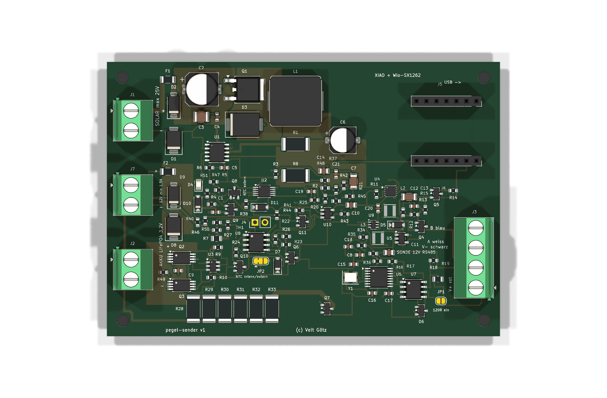

# pegel-mesh

Wasserstände von entfernten Pegeln per Funk ins Netz, ohne Mobilfunk. Ein Sender am Fluss liest die Pegelsonde (RS485) und funkt über [MeshCore](https://github.com/meshcore-dev/MeshCore) (868 MHz) zu einem Empfänger mit WLAN, der die Werte an die **hochwasserdienst**-API schickt. Der Sender läuft mit Solarpanel und LiFePO4-Akku.



## Platine

Die SMD-Teile bestückt JLCPCB (Dateien in [`hardware/pegel-sender/fab/`](hardware/pegel-sender/fab/)). Selbst löten:

| Teil | Wert | Beispiel |
|---|---|---|
| SOLAR/12V, AKKU | Schraubklemme 2-pol., Raster 5,08 mm | Phoenix MKDS 1,5/2-5,08 |
| SONDE, HEIZ/NTC | Schraubklemme 4-pol., Raster 5,08 mm | Phoenix MKDS 1,5/4-5,08 |
| L1 | Spule 15 µH, ≥ 2,4 A, radial Ø 8,7 mm, Raster 5 mm | Bourns RLB0914-150KL |
| L2 | Spule 10 µH, ≥ 0,5 A, radial Ø 8,7 mm, Raster 5 mm | Bourns RLB0912-100KL |
| C22 | Elko 220 µF 16 V, Polymer oder Low-ESR, Ø 8 mm, Raster 3,5 mm | Panasonic 16SEPF220M |
| C23 | Elko 220 µF 50 V, Low-ESR, Ø 10 mm, Raster 5 mm | Panasonic EEU-FR1H221 |
| XIAO | 2× Buchsenleiste 1×7, 2,54 mm | |
| NETZTEIL | Stiftleiste 1×2, 2,54 mm + Steckbrücke | |

Elkos: Plus an das Pad mit „+“.

Schaltplan: [`hardware/pegel-sender/preview/`](hardware/pegel-sender/preview/) (Blockschaltbild und ein Blatt je Funktionsblock), Technik in [`hardware/pegel-sender/`](hardware/pegel-sender/README.md).

## Anschlüsse

| Klemme | Was |
|---|---|
| **SOLAR/12V** | 12-V-Solarpanel (Leerlauf ≤ 25 V; 10 W Flachland, 30 W Mittelgebirge) **oder** 12-V-Netzteil |
| **AKKU** | LiFePO4, **1 Zelle** (3,2 V), z. B. 2–3 × 6 Ah parallel. 5-A-Sicherung im Pluskabel |
| **HEIZ/NTC** | H+ / H−: Heizwiderstand 68 Ω 10 W; NTC / NTC: Fühler 10 kΩ B3950, **auf den Akku** kleben |
| **SONDE** | V+ rot, V− schwarz, A weiß, B blau. RS485 Modbus RTU, 9600 8N1, Adresse 1, 12 V ≤ 30 mA |
| **NETZTEIL** (Brücke) | gesteckt bei Netzteil, offen bei Solarpanel |

Ohne NTC lädt der Sender nie (gilt als Frost). XIAO nRF52840 mit Wio-SX1262 aufstecken, USB zum Platinenrand („USB ->“); den BAT-Anschluss am XIAO nicht benutzen.

## Installation

Voraussetzungen: Git, Python 3.12+, USB-Treiber für die XIAO-Boards.

```bash
git clone https://github.com/veitforabetterworld/pegel-mesh.git
```

```bash
cd pegel-mesh && git submodule update --init
```

```bash
python3 -m pip install platformio cryptography
```

```bash
python3 tools/genkeys.py
```

`genkeys.py` legt `secrets/` an (nicht im Repo, sicher aufbewahren). Dort von Hand ausfüllen: **`secrets/receiver_wifi.h`** mit WLAN, API-Key (hochwasserdienst: Admin > API-Keys) und Name/Koordinaten der Stationen. Weitere Sender: `python3 tools/genkeys.py A B C`.

Flashen (Port anpassen, unter Windows z. B. `COM5`):

```bash
python3 tools/pio.py run -e pegel_sender_a -t upload --upload-port /dev/ttyACM0
```

| Umgebung | Gerät |
|---|---|
| `pegel_sender_a` | Sender, Messung jede Minute |
| `pegel_sender_b` | Sender, Messung alle 5 min |
| `pegel_receiver` | Empfänger, XIAO ESP32-S3 + Wio-SX1262 |

Immer `tools/pio.py` statt `pio` aufrufen; es hängt `pegel.ini` in das MeshCore-Submodul ein.

## GPS-Tracker

Der Empfänger ist zugleich Gateway für GPS-Tracker: XIAO nRF54LM20A Sense + Wio-SX1262 + L76K-GNSS-Modul (Seeed 109100021). Der Tracker schläft zwischen den Ortungen in System OFF, meldet Position und Akkustand verschlüsselt über MeshCore, speichert nicht quittierte Meldungen zwischen und reicht sie nach. Bei eingeschaltetem Bewegungsalarm weckt ihn der Bewegungssensor. Der Empfänger lädt die Meldungen zu [tracker.plenivo.de](https://tracker.plenivo.de) hoch und gibt dem Tracker dessen Einstellungen (Intervall, Alarm) mit. Firmware in [`firmware/tracker/`](firmware/tracker/), Paketformat in [`firmware/common/tracker_packet.h`](firmware/common/tracker_packet.h).

Schlüssel für einen neuen Tracker (hier `T1`), danach den Empfänger neu flashen:

```bash
python3 tools/genkeys.py --tracker T1
```

In `secrets/receiver_wifi.h` `TRACKER_API_URL` (`https://tracker.plenivo.de/api`) und je Tracker den API-Key aus dem Tracker-Dialog der Webseite eintragen. Ohne URL gibt der Empfänger die Meldungen nur auf Serial aus; Einstellungen lassen sich dann mit `tset <tracker> <intervall 0..3> <alarm 0..3> <alarmintervall 0..3>` auf Serial setzen.

Der nRF54LM20A wird von MeshCore noch nicht offiziell unterstützt; der Tracker baut gegen das Submodul `MeshCore-nrf54` (MeshCore-PR #3530). `tools/pio.py` wählt es für alle Umgebungen `tracker_*` und hängt `tracker.ini` ein.

```bash
python3 tools/pio.py run -e tracker_t1 -t upload
```

Ein neues Board ist ab Werk gesperrt (APPROTECT): einmal mit OpenOCD über den CTRL-AP löschen und dann `-t bootloader` (Bootloader, SoftDevice, Firmware) flashen; danach reicht `-t upload`. Die USB-Seriell-Brücke des Boards bleibt nach System OFF oft hängen; das Log liegt deshalb zusätzlich im RAM und lässt sich per SWD lesen (weckt den Tracker dabei auf):

```bash
bash tools/tracker_log.sh
```
