# pegel-mesh

Wasserstände von entfernten Pegeln per Funk ins Netz — ohne Mobilfunk und ohne Leitung an der Messstelle.

## Was das ist

Pegelsonde am Fluss, kleiner Sender daneben, Empfänger irgendwo mit WLAN. Der Sender liest den Pegel (RS485), funkt über [MeshCore](https://github.com/meshcore-dev/MeshCore) im 868-MHz-Band zum Empfänger; der schickt die Werte an die **hochwasserdienst**-API.

Mehrere Pegel können auf denselben Empfänger laufen. Zwei Sendermodi: Messung alle **60 s** (`pegel_sender_a`) oder alle **5 min** (`pegel_sender_b`).

Der Sender findet den Empfänger über eine geflutete Anfrage im Mesh und hält die Route per periodischer Direktanfrage aktuell. Pakete gehen als MeshCore-`RAW_CUSTOM`-Direktnachricht.

## Funk und Messwerte

Jedes Telegramm ist **13 Byte**: Pegel in mm (16 Bit), untere 16 Bit eines laufenden Zählers, Alter der Messung in Sekunden, plus 8 Byte HMAC (pro Sender eigener Schlüssel). Nicht verschlüsselt, aber fälschungssicher; der Empfänger erkennt den Sender am passenden Schlüssel. Zeitstempel für die API: Empfangszeit (UTC) minus `age_s`. Replay-Schutz über den 32-Bit-Zähler (nur 16 Bit im Funk). Implementierung: `firmware/common/pegel_packet.h`.

Statt eines Pegels kann ein Fehlercode kommen: 1 Sonde antwortet nicht, 2 Wert außerhalb des Bereichs, 3 RS485-Wandler tot, 4 Akku fast leer (unter 2,8 V). Der Empfänger reicht den Code als `status` an die API durch. Die Akkuspannung selbst geht nicht über Funk.

## Geräte

| Rolle | Modul | PlatformIO-Umgebung |
|---|---|---|
| Sender, schnell | XIAO nRF52840 + Wio-SX1262 | `pegel_sender_a` |
| Sender, sparsam | XIAO nRF52840 + Wio-SX1262 | `pegel_sender_b` |
| Empfänger | XIAO ESP32-S3 + Wio-SX1262 | `pegel_receiver` |

**Prototyp ohne Platine:** RS485-Modul an `Serial1`, in `pegel.ini` `PEGEL_BOARD=0`.

**Mit Trägerplatine** (`PEGEL_BOARD=1`, Standard): RS485 über SC16IS740 (I²C), Sonde schaltbar an D0, Akku über INA226 — siehe unten.

## Sender-Trägerplatine

Träger für XIAO nRF52840 + Wio-SX1262: Versorgung aus Solar oder 12-V-Netzteil, LiFePO4 1S optional, 3,3 V für den Funk-Stack, 12 V für die Pegelsonde (nur bei Messung), RS485 zur Sonde. Geplant für IP65-Gehäuse ~115 × 90 mm; KiCad-Projekt und Fertigungsdaten unter `hardware/pegel-sender/` (Gerber, BOM, CPL in `fab/`).

### Anschlüsse

| Klemme | Belegung |
|---|---|
| SOLAR | + / − (Panel typ. 10–20 W, Leerlauf bis 25 V) |
| 12V | + / − (Netzteil mindestens 12 V / 1,5 A) |
| AKKU | + / − (LiFePO4 1S, z. B. 3× 32700 parallel, optional) |
| SONDE | V+ rot, V− schwarz, A weiß, B blau (12–24 V, RS485 Modbus RTU, < 50 mA) |

Solar und Netzteil dürfen gleichzeitig stecken; die höhere Spannung speist, keine speist in die andere zurück. Der Akku ist optional: ohne Zelle hält der Lader die Platine auf 3,61 V.

| Betrieb | Verhalten |
|---|---|
| Solar mit Akku | Laden und Puffern, MPPT bei etwa 18 V |
| Netzteil mit Akku | Laden aus 12 V |
| Solar ohne Akku | Funk und Sonde direkt aus dem Panel |
| Netzteil ohne Akku | Funk und Sonde direkt aus 12 V |

Sonde nur während der Messung unter Spannung (MOSFET, Steuerung **D0**). Frost unter 0 °C sperrt nur das Laden, die Platine läuft weiter; die Heizung (~5 W) kommt aus Solar oder Netzteil, nicht aus dem Akku. Unter 2,8 V lässt der Sender die Sonde aus und meldet Fehlercode 4; ab 3,0 V wieder Pegel.

**XIAO-Stapel:** Stiftleisten 2,54 mm unter dem XIAO, 2× 7-pol. Buchsen auf der Platine. **BAT am XIAO unbenutzt** — der eingebaute Li-Ion-Lader darf die LiFePO4-Zellen nicht sehen. USB-Flashen bei montiertem Akku: der XIAO läuft aus USB, eine ideale Diode (LM66100) sperrt den Rückweg in den 3,3-V-Wandler und den Akku.

| Pin | Funktion |
|---|---|
| D1–D5, D8–D10 | Wio-SX1262 |
| D6 / D7 | I²C (INA226, SC16IS740) |
| D0 | Sondenversorgung ein (HIGH) |

### Schaltung (Überblick)


Kernbauteile: CN3795 + 15 µH (Lader), HY2112 + Dual-MOSFET (Zellschutz), TPS63900 (3,3 V), TPS61040 + Lastschalter (Sonden-12 V), INA226 + 10 mΩ Shunt, SC16IS740 + MAX3485 (RS485). MPPT-Arbeitspunkt am Panel etwa 18 V; unter etwa 14 V (Netzteil) wird der Teiler entspannt. Bei anderem Panel den Solar-Teiler anpassen.

Ansicht Bestückungsseite und Lötseite (KiCad-3D-Render):

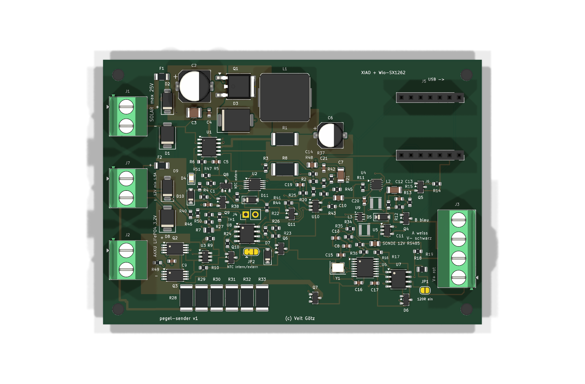

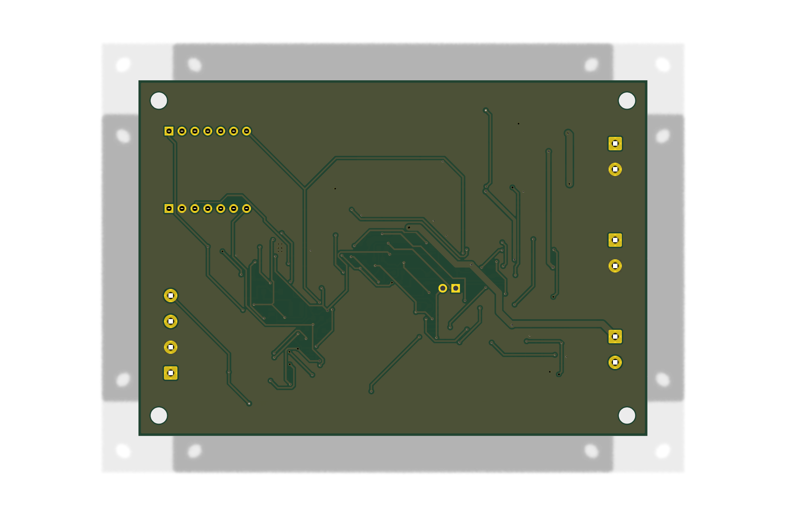

Schaltplan je Funktionsblock (Symbole und Leitungen):

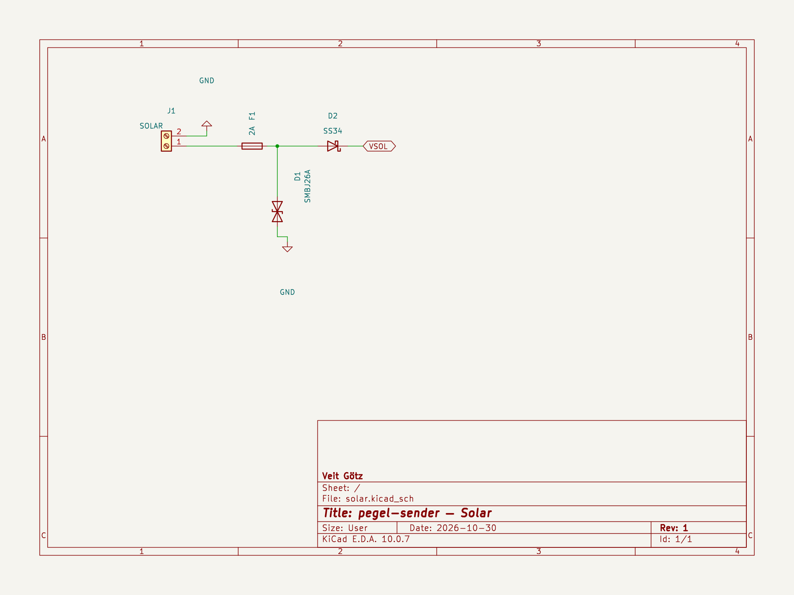

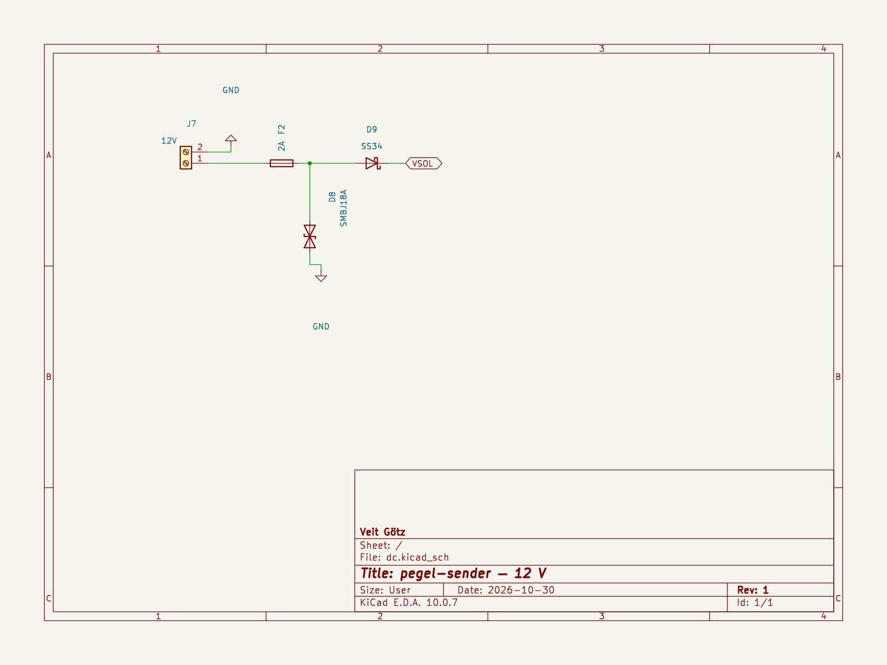

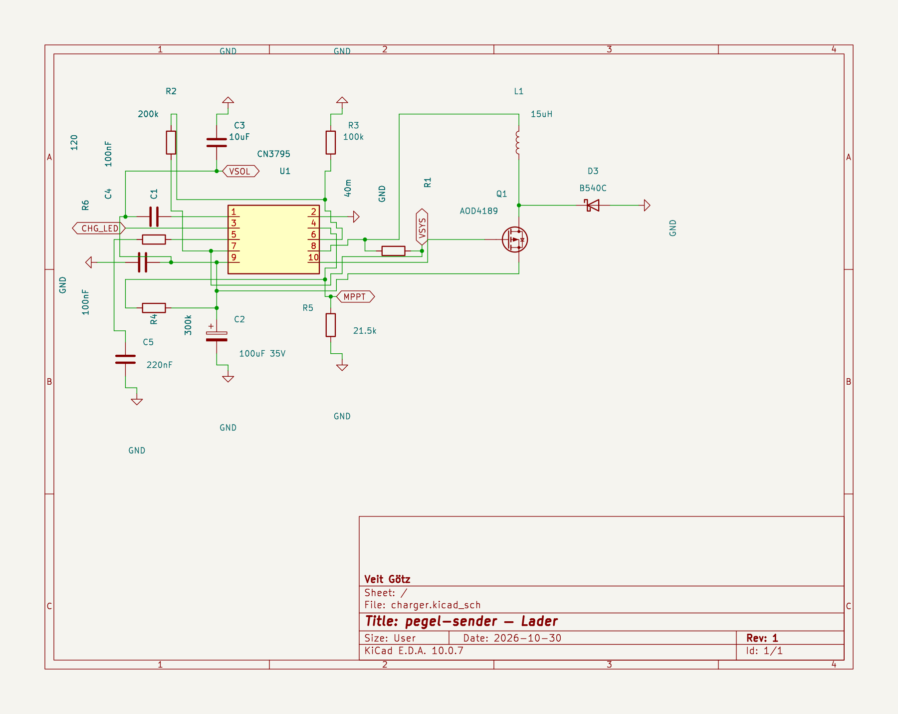

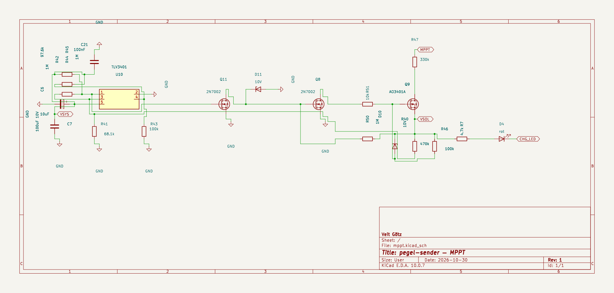

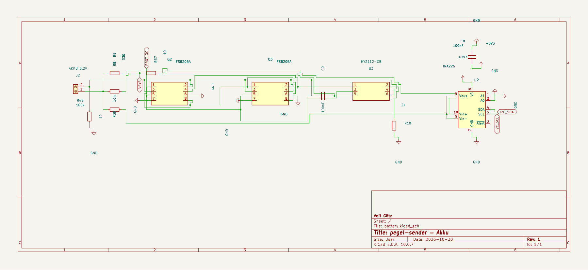

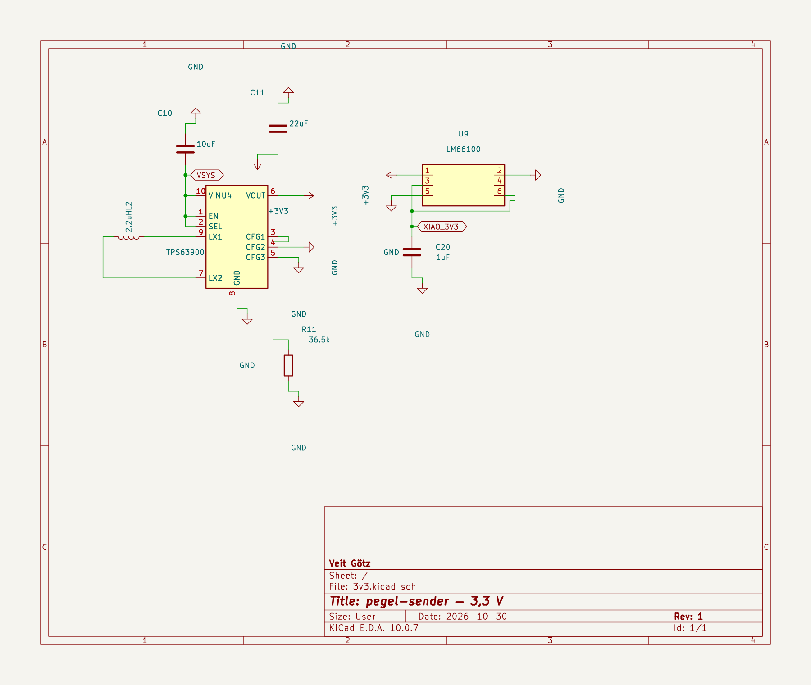

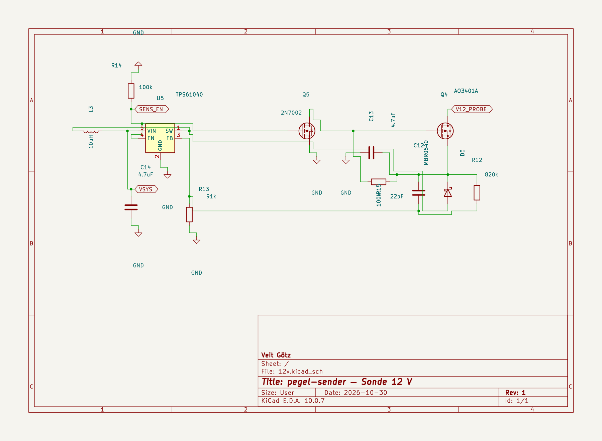

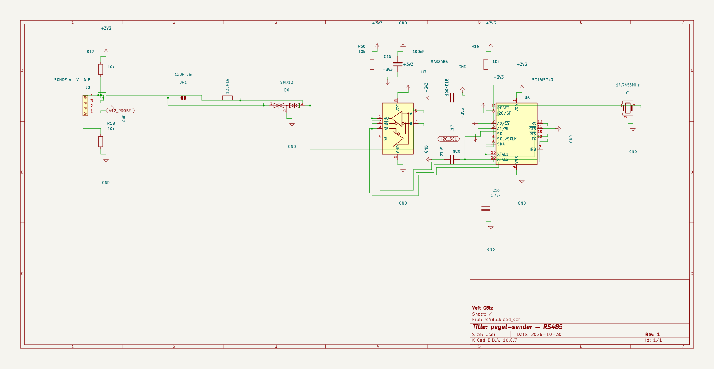

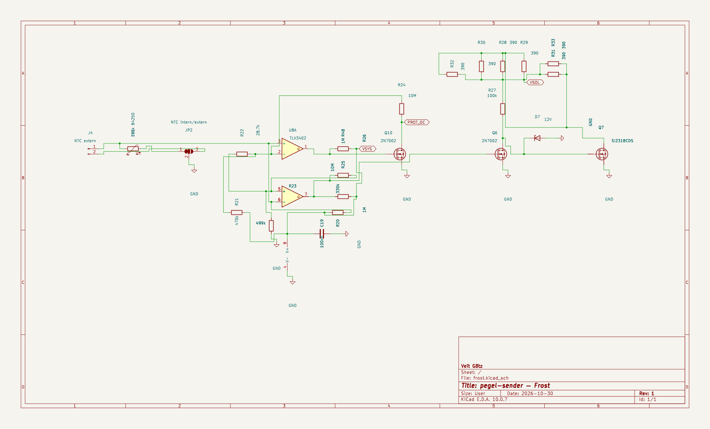

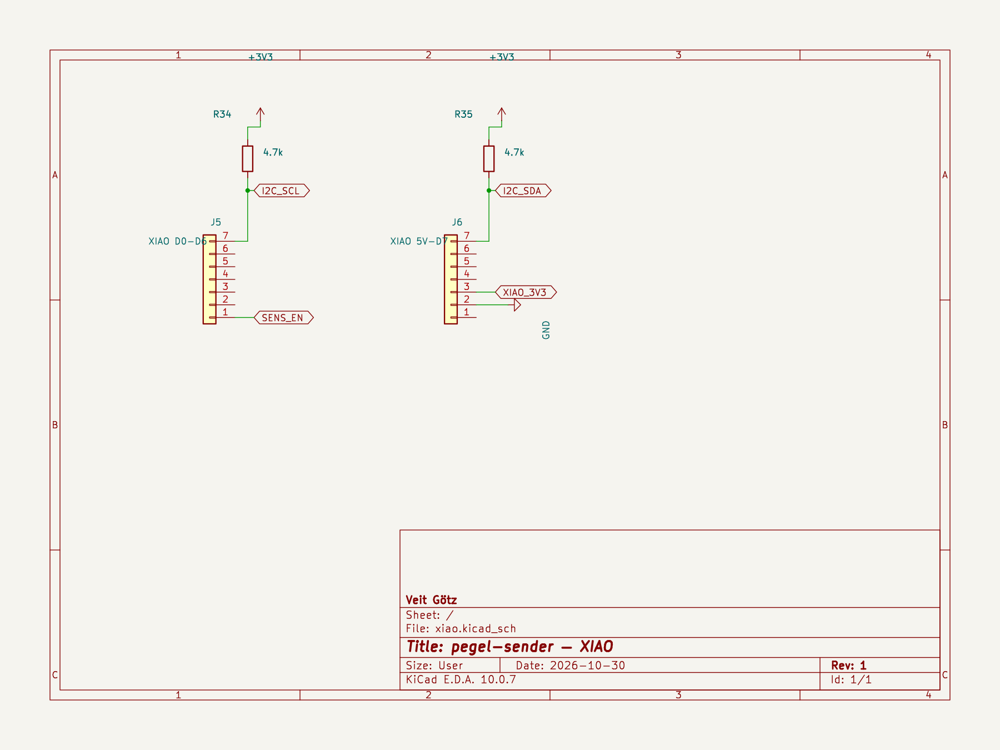

### Platine und Schaltplan erzeugen

**Software:** [KiCad 10](https://www.kicad.org/download/), **Java (JRE)** für [Freerouting 2.5](https://github.com/freerouting/freerouting/releases) (`hardware/pegel-sender/build/freerouting.jar`, nicht versionieren).

| Plattform | KiCad |
|---|---|
| Linux (Arch/Manjaro) | `pacman -S kicad kicad-library jre-openjdk` |
| Linux (ohne root) | KiCad-AppImage nach `hardware/pegel-sender/build/kicad-appimage/` ([Download](https://www.kicad.org/download/linux/)); beim ersten Lauf extrahiert [`kicad_env.py`](hardware/pegel-sender/kicad_env.py) `squashfs-root` |
| Windows | KiCad-Python und `kicad-cli.exe` neben der Installation |

Im Verzeichnis `hardware/pegel-sender/`:

1. `python3 design.py` — Netzliste prüfen  
2. KiCad-Python: `gen_pcb.py`  
3. `route.py build/freerouting.jar` — DRC: 0 offen, 0 Kurzschluss/Kreuzung, 0 Siebdruck-Verstöße  
4. `export.py` — Gerber/BOM/CPL nach `fab/`  
5. `render_preview.py` — 3D-Bilder nach `preview/`  
6. `schematic_blocks.py` — Blockschaltplan; `export_schematic.py` — Schaltplan je Funktionsblock  

**Platine neu erzeugen:** `python3 relayout.py` (Schritte 2–5). Bauteilpositionen stehen in `fixed_positions.py`; nach manueller Verschiebung in KiCad: KiCad-Python `dump_fixed.py` → `fixed_positions.py` aktualisieren, dann `relayout.py`.

**Nur Siebdruck** auf gültiger Platine: KiCad-Python `gen_pcb.layout_silk(board)` speichern, dann `render_preview.py`.

Quelle für Bauteile und Netze: [`design.py`](hardware/pegel-sender/design.py). Schaltplan-Grafiken: `schematic_wired.py`. L1-3D: `3dmodels/L_Bourns_SRP1245A.step` (KiCad-2313AA-STEP auf 13,5×12,5×4,8 mm skaliert in `gen_pcb.py`).

Platine 100 × 70 mm, 2 Lagen. Vor PCB-Bestellung Abstand der XIAO-Buchsen am realen Stapel messen (Soll 15,24 mm Reihenabstand). Siebdruck: `(c) Veit Götz`.

## Installation

**Voraussetzungen:** Git, Python 3.12+, USB-Treiber für die XIAO-Boards.

```bash
git clone <repo-url> pegel-mesh
cd pegel-mesh
git submodule update --init

python3 -m pip install platformio cryptography
python3 tools/genkeys.py
```

`tools/genkeys.py` legt `secrets/` an (nicht versioniert): Mesh-/WLAN-Daten, API-Zugang für den Empfänger, HMAC-Schlüssel pro Sender. **Sicher aufbewahren** — bei Verlust alle Geräte neu flashen.

```bash
python3 tools/pio.py run -e pegel_sender_a -t upload --upload-port /dev/ttyACM0
python3 tools/pio.py device monitor -b 115200 -p /dev/ttyACM0
```

Port anpassen (`COM5` unter Windows). Weitere Umgebungen: `pegel_sender_b`, `pegel_receiver`. Immer `tools/pio.py` nutzen — hängt `pegel.ini` in das MeshCore-Submodul ein.
