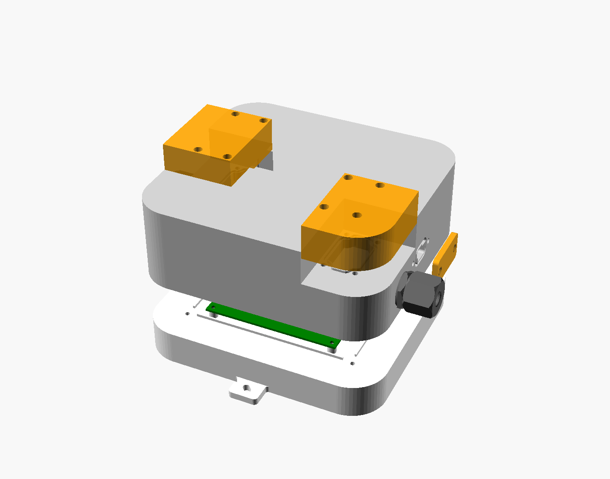
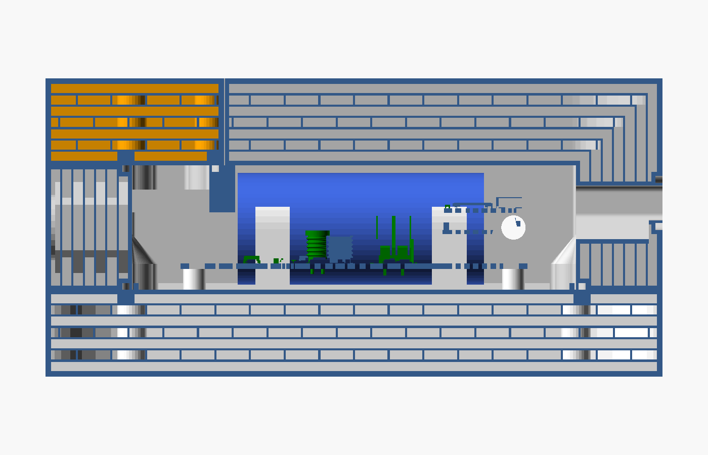
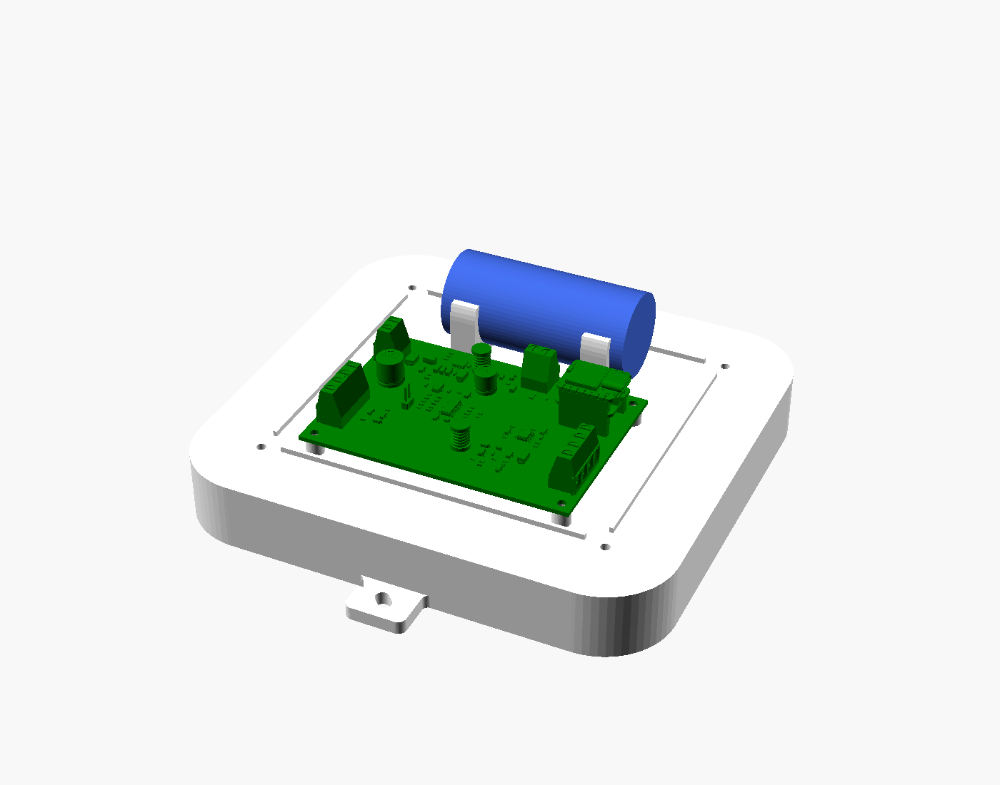
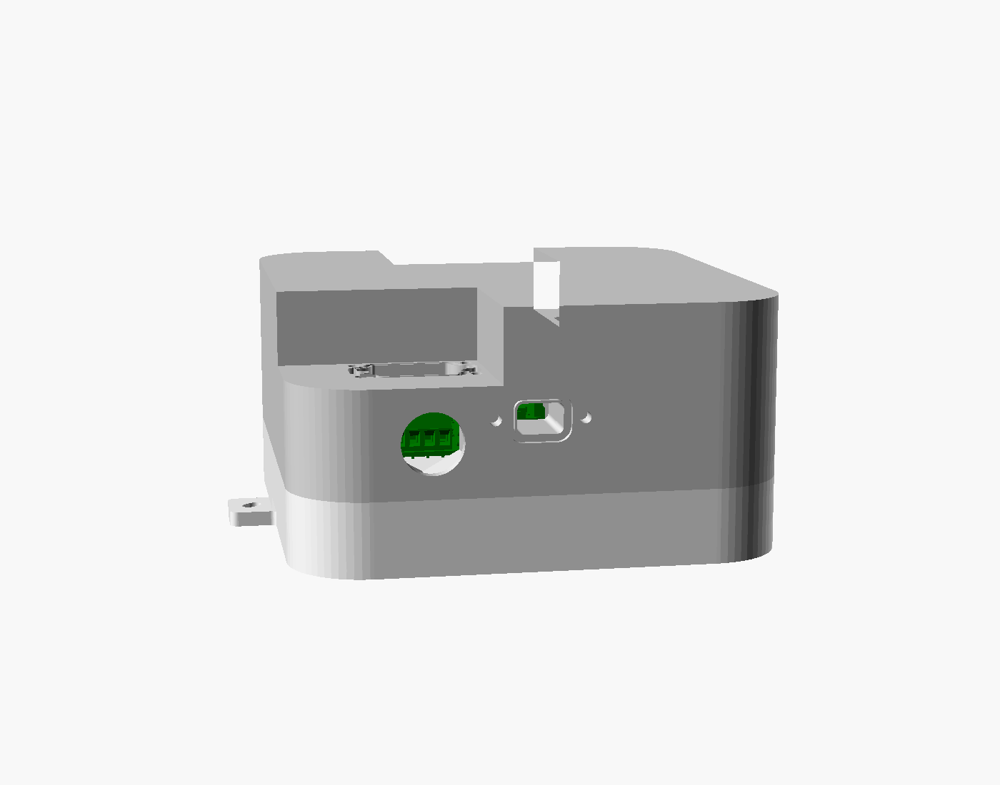
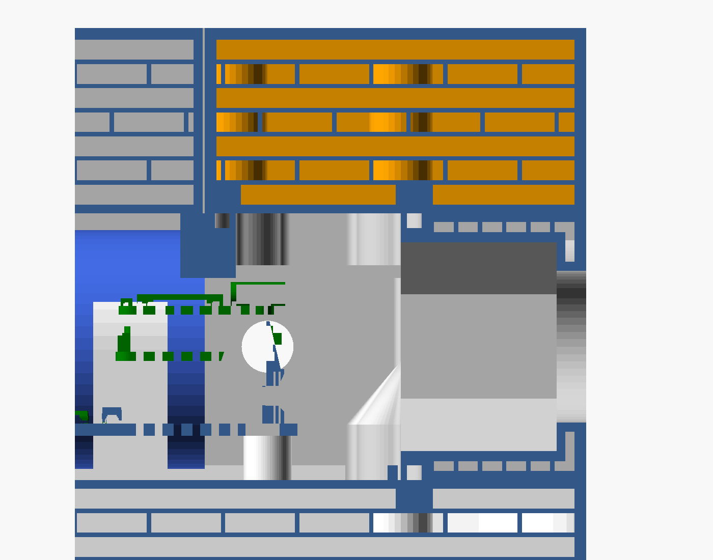
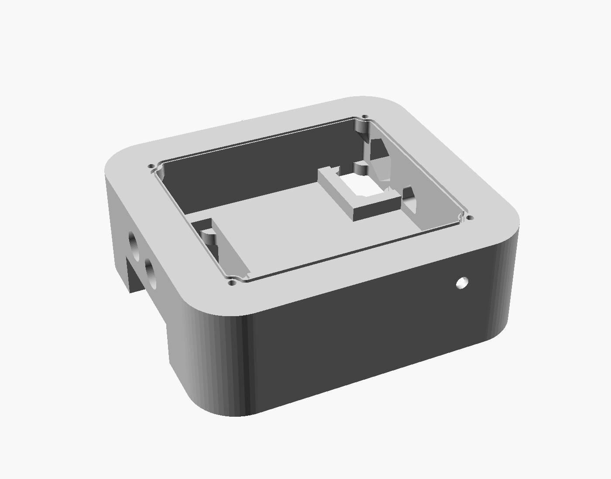

# Gehäuse pegel-sender-12v

Wärmegedämmtes Außengehäuse für die Platine (100 × 70 mm) und eine LiFePO4-Zelle **IFR32700**, nach dem Prinzip des Funklicht-Gehäuses: Platine und Zelle sitzen auf dem Bodendeckel an der Wandseite, über den Klemmen für die Außenkabel liegen verschraubte Deckel. Wände, Front, Bodendeckel und Klemmendeckel sind **25 mm** stark und bestehen aus **7 geschlossenen Luftkammern** hintereinander. Die Kammern sind CAD-Geometrie, nicht Slicer-Infill.

 
 
 

Schnitte (blau = Schnittfläche Material, grau = Kammerwände): oben rechts quer durch Gehäuse, Front, SOLAR-Deckel (orange), Bodendeckel und USB-Tunnel bei y = 52,4; unten links Ecke rechts unten durch die M20-Tasche (4 mm Außenhaut) und den SONDE-Deckel.

Außen **178 × 164 × 86 mm** (Gehäuse 61 + Bodendeckel 25, ohne Wandlaschen; mit Laschen 196 mm hoch), innen unverändert 128 × 114 × 36 mm. Außenkontur = Innenkontur + 25 mm (Eckradius 26 mm), damit die Dämmung überall gleich dick ist.

## Wandaufbau

Von innen nach außen (Parameter `k_*` im SCAD):

| Schicht | Dicke | Anmerkung |
|---|---|---|
| Innenhaut `k_si` | 1,2 mm | |
| 7 × Luftkammer `k_d` | je 2,66 mm | dazwischen 6 Trennwände `k_s` = 0,6 mm |
| Außenhaut `k_so` | 1,6 mm | wasserdicht (4 Linien bzw. 8 Lagen) |
| **gesamt** | **25 mm** | 7 × 2,66 + 6 × 0,6 + 1,2 + 1,6 |

- **Stege** `k_rib` = 0,6 mm verbinden die Trennwände:
  - In den **Seitenwänden** (beim Druck senkrecht) nur alle 30 mm, quer zur Wand, von Lage zu Lage um 15 mm versetzt. Sie dienen nur der Steifigkeit.
  - In **Front, Bodendeckel und Klemmendeckeln** (beim Druck waagrecht) alle 10 mm. Jede Kammerdecke ist damit eine Brücke von höchstens 9,4 mm. Die Stegrichtung wechselt von Lage zu Lage (x/y), jede zweite gleichgerichtete Lage ist um 5 mm versetzt. Stege benachbarter Lagen berühren sich also nur an Kreuzungspunkten, es gibt keine durchgehende Wärmebrücke.
- Die Kammern in Wand und Front sind **verschachtelte Schalen** um den Innenraum und laufen über die Kante Wand/Front durch, dort gibt es keinen massiven Eckbalken.
- **Warum viele dünne Kammern statt weniger dicker:** Bei Spalten unter etwa 6 mm leitet die Luft nur noch, Konvektion spielt keine Rolle (gilt auch für Wärmestrom nach oben). Den Rest überträgt Strahlung, und zwar je Spalt etwa gleich viel, egal wie breit er ist. Jede zusätzliche Trennwand ist deshalb ein weiterer Strahlungsschirm. 5-mm-Kammern ergeben in der Rechnung λ ≈ 0,050, 2,66-mm-Kammern λ ≈ 0,046 (ohne Stege).
- **Kelvin- oder Gyroid-Zellen geprüft und verworfen:**
  - Bei gleicher Wanddicke ist eine Schichtung quer zum Wärmestrom die beste Anordnung. Jede Zellwand parallel zum Wärmestrom ist eine Wärmebrücke, und isotrope Zellen haben viele davon.
  - Die gemessenen 0,037–0,038 W/(m·K) der Kelvin-Proben beruhen auf etwa 90 % Porosität mit sehr dünnen Wänden. Mit Düse 0,4 und dichten (geschlossenen) Zellwänden ist das nicht erreichbar.
  - Gyroide sind offenzellig. Feuchte und Kondensat könnten darin wandern.
  - OpenSCAD 2021 kann keine impliziten Flächen. Man bräuchte ein externes Marching-Cubes-Netz, und CGAL wäre damit kaum noch rechenbar.

### Rechnung (`daemmung.py`)

Luftschicht nach ISO 6946: R = 1 / (h_a + h_r), h_a = 0,025 / d (Leitung), h_r = 4,2 W/(m²K) (Strahlung, ε = 0,9, 10 °C). Die Formel ergibt die Tabellenwerte der Norm (5 mm → 0,11, 10 mm → 0,15). Für d = 2,66 mm: R = 0,0735 m²K/W. PETG λ = 0,20.

| | R ohne Stege | R′ (obere Grenze) | R″ (untere Grenze) | R = (R′+R″)/2 | **λ_eff** |
|---|---|---|---|---|---|
| Seitenwand (Stege 30 mm) | 0,546 | 0,537 | 0,504 | 0,520 | **0,048** (0,047–0,050) |
| Front/Deckel (Stege 10 mm) | 0,546 | 0,518 | 0,436 | 0,477 | **0,052** (0,048–0,057) |
| 2 cm EPS (λ 0,035 / 0,040) | | | | 0,57 / 0,50 | |

- R′ und R″ sind die Grenzen des ISO-6946-Verfahrens für inhomogene Schichten. R″ setzt voraus, dass jede 0,6-mm-Trennwand die Wärme seitlich vollständig verteilt. Das ist bei so dünnen Wänden zu pessimistisch, der wahre Wert liegt eher zwischen Mittel und R′.
- Mit λ_PETG = 0,25 statt 0,20 wird es etwa 0,001–0,002 schlechter.
- **Ergebnis:** Das Ziel λ_eff ≤ 0,045 wird **nicht ganz erreicht**. Die Seitenwände kommen auf etwa 0,048, Front und Deckel wegen der dichteren Brückenstege auf etwa 0,052.
- Ohne Stege wäre die Grenze dieses Aufbaus 0,046. Mit 8–9 Kammern (2,25 bzw. 1,9 mm) läge sie bei 0,0445, real mit Stegen bei etwa 0,047/0,051. Dafür bräuchte man mehr Material und noch dünnere Kammern. Mit FDM-tauglicher Geometrie (Trennwand ≥ 0,6 mm, Brücke ≤ 10 mm) sind **etwa 0,046–0,048** das Bestmögliche.
- Der Wärmewiderstand der Wand (R ≈ 0,48–0,52 m²K/W) entspricht damit **etwa 2 cm EPS mit λ 0,040** bzw. 85–90 % von EPS mit λ 0,035.

**Ganzes Gehäuse** (Formfaktor für dickwandige Kästen, Rsi 0,13 / Rse 0,04):

| Posten | UA |
|---|---|
| Wände, Front, Deckel (Regelquerschnitt) | 0,090 W/K |
| Fuge hinten (Dichtrand, Deckelhaut, massive Lage unter der Dichtung) | + 0,012 |
| Ränder der Klemmendeckel-Aussparungen | + 0,008 |
| 3 Verschraubungstaschen (4 mm Restwand) | + 0,007 |
| 12 Schraubentaschen, Antenne, USB-Tunnel, Einschmelzhülsen | + 0,005 |
| **gesamt** | **≈ 0,12 W/K** (R ≈ 8 K/W) |
| zum Vergleich: gleicher Innenraum in 2 cm EPS, ohne Brücken | 0,078–0,086 W/K |

Die Heizung mit 2,1 W hält den Innenraum also stationär rund 17 K über der Außentemperatur, bei 1 W etwa 8 K. Kabel (Kupfer) und Wandmontage sind nicht berücksichtigt.

**Gemessen** sind nur die Literaturwerte, auf denen die Rechnung aufbaut:
- ISO-6946-Luftschichten
- PETG 0,20–0,29
- EPS 0,035–0,040
- FDM-Proben: Anwajler et al. 2024 (Kelvin PLA 0,037–0,052, optimistisch gemessen), Lopes et al. 2023 (PETG-Infill 0,057–0,090), Piccioni et al. 2020 (Gyroid/Diamond PETG ≈ 0,07)

**Geschätzt** ist alles in diesem Abschnitt. Am Gehäuse ist nichts gemessen. Die FDM-Messungen zeigen, dass Druckfehler, undichte Lagen und Strahlung durch dünne Wände in der Praxis oft 10–30 % schlechtere Werte ergeben als die Rechnung.

### Was massiv bleibt (und warum)

Um jede Bohrung, Nut und Tasche bleibt `k_sleeve` = 1,2 mm Material stehen, das die Kammern schließt. Massiv bleiben außerdem:

- **Hinterer Dichtrand:** 1,2 mm Massivschicht über den ganzen Rand, im Bereich der Nut 3,2 mm (Nut 2 + 1,2). Im Bodendeckel ist unter der Dichtschnur die erste Kammerlage massiv, damit die gebrückte Deckhaut unter der Verpressung nicht nachgibt. Bei den Klemmendeckeln gilt dasselbe.
- **Klemmendeckel-Aussparungen:** Die Wand unter dem Deckelsitz ist oben 1,2 mm geschlossen, die Kammern enden ringsum mit 1,2 mm Wand.
- **Einschmelzmuttern:** Eckblöcke hinten, Ecken der Klemmenöffnungen und USB-Deckel (jetzt von außen direkt in die Wand) jeweils mit Hülse.
- **Schraubentaschen:**
  - Bodendeckel (4×) und Klemmendeckel (8×) werden mit **M3-Zylinderschrauben aus Ø-6,2-Taschen** verschraubt. Der Kopf sitzt auf 4 mm Boden, die Schraube ist nur 10 mm lang.
  - Durchgehende M3 × 30 aus Stahl wären 12 Wärmebrücken mit zusammen bis zu 0,17 W/K, also mehr als das ganze Gehäuse.
  - Die Taschen sind offen. Optional mit einem Tropfen Silikon oder einem Stopfen schließen.
- **Kabelverschraubungen:**
  - Von innen eine Sechskanttasche (SW + 0,4) bis an die **4 mm dicke, massive Außenhaut**. Außen ist die Wand plan, darauf sitzen Bund und Flachdichtung (Planfläche ≥ Eckmaß + 1 mm, geprüft). Innen liegt die Kontermutter verdrehsicher in der Tasche. Man zieht also außen am Bund bzw. Körper an.
  - Solar 2 × **M16** (Loch 16,5, SW 20, Abstand 26 mm), Sonde 1 × **M20** (Loch 20,5, SW 24, jetzt bei y = 18, damit der Bund frei vom USB-Deckel bleibt).
  - Gedruckte Verschraubungen aus [printable-cable-gland](https://github.com/veitforabetterworld/printable-cable-gland), eingebunden als Git-Submodul unter `lib/printable-cable-gland` (nach dem Klonen im Repo-Root `git submodule update --init`). Lochdurchmesser, Schlüsselweite und Höhe der Kontermutter, Mindestabstand und die Hüllen für die Prüfungen kommen direkt aus der Bibliothek (`cable_gland_hole_d`, `cable_gland_nut_af/_h`, `cable_gland_spacing`, `cable_gland_envelope`). Die Druckteile stehen dort unter `stl/M16_5-6.5` und `stl/M20_6.5-9`. Handelsübliche Verschraubungen mit Gewinde ≥ 9 mm passen ebenfalls.
- **Antenne:** Ø 7 durch 3 mm Außenhaut. Innen eine Sechskanttasche SW 8,4 für den Körper einer SMA-Einbaubuchse, die Mutter sitzt außen. Bei anderer Durchführung `ant_pocket` und `ant_wall` anpassen.
- **USB:**
  - Tunnel 15 × 10 mm durch die ganze Wand. Innerhalb der Wand hat er ein 45°-Dach, damit der Druck ohne 15-mm-Brücke auskommt.
  - Der USB-Deckel bleibt eine 4-mm-Platte. Begründung: Der Tunnel hat nur 150 mm² Querschnitt, seine ruhende Luftsäule hat selbst R ≈ 0,18. Die Mehrverluste liegen bei unter 0,001 W/K, ein gedämmter Stopfen würde das nicht lohnen.
  - Die Buchse liegt jetzt **40,6 mm** hinter der Außenfläche. Der Stecker-Umspritzling (bis 12,4 × 6,6 mm) passt durch den Tunnel (geprüft), muss aber am Kabel hineingeschoben werden.
- **Wandlaschen:** 5 mm dick, 16 mm lang. Der Schraubenkopf liegt 8 mm neben dem 86 mm hohen Gehäuse, der Schraubendreher sollte mindestens 100 mm Schaft haben.

## Aufbau

- **Gehäuse** (Haube): Wände und Front aus einem Stück, hinten über den ganzen Innenraum offen. Die hinteren Eckblöcke tragen die Einschmelzmuttern für den Bodendeckel. Ihr Grundriss ist ein Viertelkreis-Dom um die Schraube mit Hohlkehlen (Komplement des gerundeten Dichtbereichs), darüber eine 45°-Fase zur Seitenwand.
- **Dichtbahnen:** Der Dichtbereich ist die Öffnung minus Kreise mit R 6 mm um jedes Schraubloch. Die Nut läuft deshalb **konzentrisch um jedes Loch** (R 3,2–5,2 mm, 1,2 mm Material zum Einschmelzloch Ø 4), die Übergänge Bogen ↔ Wand/Steg sind mit R 1,5 gerundet. Das gilt für den Bodendeckel und für beide Klemmendeckel.
- **Bodendeckel** (Wandseite):
  - Platine auf 4 Domen (6 mm hoch, die Pins stehen unten 3,0 mm über).
  - Zelle in 2 Rastsätteln, Wandlaschen mit 45°-Langlöchern.
  - Mit 4 M3-Zylinderschrauben aus Taschen von hinten an die Eckblöcke geschraubt, Dichtung in der Nut im Gehäuserand.
- **Klemmendeckel SOLAR** (links über J1) und **SONDE** (rechts über J3):
  - Gedämmte Stopfen, 25 mm dick, die die Aussparung in der Front ausfüllen (Fuge 0,3 mm).
  - Je 4 M3-Zylinderschrauben aus Taschen, eigene Dichtung auf dem Quersteg bzw. auf der Wandkrone.
  - Mit abgenommenem Deckel kommt ein Schraubendreher Ø 3 mm senkrecht an alle Klemmenschrauben (Schaft ≥ 40 mm).
- **AKKU (J2)** und **HEIZ/NTC (J4)** werden innen fest verdrahtet, bevor der Bodendeckel zugeschraubt wird.

Noch nicht vorgesehen: ein Halter für den Heizwiderstand (68 Ω 10 W).

## Dateien

| Datei | Inhalt |
|---|---|
| `pegel_sender_gehaeuse.scad` | Gehäuse, Deckel, Dichtungen, Kammern, Prüfungen (Schalter `part`) |
| `daemmung.py` | Wärmerechnung zum Kammeraufbau (`python3 daemmung.py`) |
| `platine_bauteile.scad`, `platine.stl` | **erzeugt** mit `gen_platine.py` aus `../pegel-sender-12v.step`: Hüllquader je Bauteil (Prüfungen) und Ansichtsmodell |
| `stl/` | Druckdateien |

```bash
../build/step-venv/bin/python gen_platine.py
openscad -D 'part="gehaeuse"' -o stl/gehaeuse.stl pegel_sender_gehaeuse.scad
```

Mit OpenSCAD 2021.01 (CGAL) dauert das Gehäuse mit Kammern etwa 1,5 Minuten. `-D kammern=false` erzeugt massive Teile (schnell, für Ansichten).

## Druck

| Teil (`stl/`) | Material | Druck | Volumen |
|---|---|---|---|
| `gehaeuse.stl` | PETG | Front aufs Bett (schon gedreht), ohne Stützen | 341 cm³ |
| `bodendeckel.stl` | PETG | Wandseite aufs Bett | 251 cm³ |
| `klemmdeckel_solar.stl`, `klemmdeckel_sonde.stl` | PETG | Außenseite aufs Bett | je 33 cm³ |
| `usb_deckel.stl` | PETG | Außenseite aufs Bett | 3 cm³ |
| `dichtung.stl`, `klemmdichtung_*.stl`, `usb_dichtung.stl` | TPU 95A | flach, 100 % Infill | |

Zusammen etwa 660 cm³ ≈ 0,85 kg PETG.

**Einstellungen (Düse 0,4):**

- **Schichthöhe 0,2 mm.** Die waagrechten Trennwände sind dann 3 Lagen, die Außenhaut 8 Lagen.
- **Arachne-Wandgenerator** (PrusaSlicer/Orca/Bambu Standard). Die 0,6-mm-Trennwände und -Stege werden so zu einer Linie mit 0,6 mm Breite. Ohne Arachne „dünne Wände erkennen“ einschalten und in der Vorschau prüfen, dass keine Trennwand fehlt.
- **Wandlinien ≥ 4, obere/untere Schichten ≥ 1,0 mm.** Dann sind alle Häute und Hülsen voll. Die waagrechten Häute sind dünner als die Deckschichten und werden automatisch massiv.
- **Infill 15–40 %, beliebiges Muster.** Er betrifft nur die wenigen dicken Massivteile (Eckblöcke, Quersteg, Schraubdome, Laschen). Für die Dämmung sind **keine Infill-Einstellungen nötig**, die Kammern sind Geometrie.
- **Brücken:** Brückenerkennung an, Lüfter bei Brücken 100 %. Die Kammerdecken überspannen 9,4 mm (Front und Deckel) bzw. 2,7 mm (Kammerenden in den Wänden).
- Keine Stützen. Überhänge sind ≤ 45°: Eckblock-Fasen, 60°-Dächer der Sechskanttaschen, USB-Tunnel mit Dach.
- In der Slicer-Vorschau stichprobenartig einige Lagen ansehen: Trennwände durchgehend, Kammern oben und unten zu.
- Optional innen Alu-Klebeband auf die Innenwände kleben. Das reflektiert einen Teil der Strahlung im Innenraum, an den Kammern ändert es nichts.

## Prüfungen

Alle Prüfungen ergeben ein leeres Objekt bzw. nur Flächenkontakt (Volumen 0). Die Kollisionsprüfungen rechnen mit massiven Teilen (`gehaeuse(false)`), weil die geschlossenen Kammern keine Innen- oder Außenfläche verändern. Dass sie geschlossen sind, zeigen die `kollision_kammern_*`.

| Prüfung | Was |
|---|---|
| `kollision` | Gehäuse, Deckel ↔ Platine, Zelle (Flächenkontakt Dome/Sättel) |
| `kollision_einbau` | bestückte Platine von hinten einsetzbar |
| `kollision_schraubendreher` | Ø 3 mm senkrecht auf alle Klemmenschrauben bis vor die Front (Deckel ab) |
| `kollision_kontermutter` | Kontermuttern SW 20 / 24 in den Taschen frei |
| `kollision_verschraubung` | Hülle der eingebauten Verschraubung außen (Bibliothek, 1 mm Schlüsselraum) frei von Deckeln und Laschen |
| `kollision_verschraubung_innen` | Gewindeschaft innen frei in der Tasche, nicht an Platine oder Zelle |
| `kollision_zelle`, `kollision_bodendeckel`, `kollision_klemmdeckel`, `kollision_usb_deckel` | Teile untereinander |
| `kollision_usb_stecker` | Umspritzling 12,4 × 6,6 mm von der Buchse bis 10 mm vor die Außenfläche frei |
| `kollision_nut_deckel` | alle Dichtnuten liegen vollständig unter ihrem Deckel |
| `kollision_kammern_gehaeuse`, `_bodendeckel`, `_klemmdeckel` | Kammern haben überall ≥ 1,0 mm Material zu Innenraum, Außenluft, Nuten, Bohrungen, Taschen und Aussparungen, sind also geschlossen. Gegenprobe mit `-D k_min=1.3` ist nicht leer, die Prüfung greift also. |

## Kleinteile

| Anz. | Teil | Wofür |
|---|---|---|
| 18 | Einschmelzmutter M3 (z. B. M3 × 5,7, Bohrung 4,0 mm) | 4 Bodendeckel, 8 Klemmendeckel, 2 USB-Deckel (von außen setzen), 4 Platine |
| 12 | Zylinderschraube M3 × 10 (ISO 4762) | Bodendeckel 4, Klemmendeckel 8 (aus den Taschen) |
| 2 | Senkkopfschraube M3 × 10 (DIN 7991) | USB-Deckel |
| 4 | Zylinderschraube M3 × 6 | Platine |
| 2 + 1 | Kabelverschraubung M16 (Kabel 5–6,5 mm) und M20 (6,5–9 mm), gedruckt aus `lib/printable-cable-gland/stl/` (PETG + TPU), Wand 4 mm | Solar 2 × M16, Sonde M20 |
| 1 | SMA-Einbaubuchse (Sechskant SW 8, Loch 7 mm, Wand 3 mm) | 868-MHz-Antenne |

## Montage

1. Einschmelzmuttern setzen (USB-Deckel von außen).
2. Kabelverschraubungen von außen durchstecken. Die Kontermutter liegt innen in der Sechskanttasche, angezogen wird außen am Körper. Antennenbuchse von innen in ihre Tasche, Mutter außen.
3. Platine auf den Bodendeckel schrauben, XIAO + Wio-SX1262 aufstecken, Zelle in die Sättel drücken, Akku, Heizung, NTC und Antennenkabel anschließen.
4. Dichtung in die hintere Nut legen, Gehäuse aufsetzen, 4 × M3 × 10 aus den Taschen von hinten.
5. Über die Laschen an die Wand schrauben.
6. Solar und Sonde durch die Verschraubungen führen und anklemmen, Klemmdichtungen einlegen, Klemmendeckel mit 4 × M3 × 10 aufschrauben.

## Offene Punkte / Risiken

- **Druckbarkeit:**
  - Etwa 0,85 kg PETG und lange Druckzeit, weil jede Lage viele kleine geschlossene Konturen hat.
  - Einlinien-Trennwände (0,6 mm) und 9,4-mm-Brücken sind machbar, aber vorher an einem Probestück prüfen (z. B. Klemmendeckel zuerst drucken und aufsägen).
- **Dichtheit der Kammern:** Kleine Löcher in inneren Trennwänden schaden thermisch kaum. Entscheidend ist die Außenhaut (1,6 mm, 4 Linien). Sie sollte nach dem Druck auf Wasserdichtheit geprüft werden (Tauchtest, wie bei den Verschraubungen beschrieben). Für dauerhaften Außeneinsatz ist ein Lack oder Epoxid außen sinnvoll.
- **Kondensat:**
  - Die Kammern sind geschlossen, es gibt keinen Luftaustausch und damit kaum Feuchteeintrag.
  - PETG nimmt aber etwas Wasser auf und diffundiert langsam. Bei warm-feuchter Innenluft und Frost außen kann sich in den äußeren Kammern über Jahre etwas Feuchte sammeln.
  - Die Innenhaut ist die Dampfbremse. Gegebenenfalls innen Alu-Klebeband aufbringen, das ist zugleich ein Strahlungsschirm.
- **USB:** Die Buchse sitzt 40,6 mm tief. Nicht jeder Stecker lässt sich am Kabel sicher einschieben. Notfalls ein kurzes USB-C-Verlängerungskabel mit schlankem, langem Stecker verwenden.
- **Verschraubungen:** Die gedruckten Verschraubungen sind noch nicht gedruckt und nicht auf Dichtheit geprüft (siehe README der Bibliothek); vorher die Gewinde-Testprobe drucken.
- Die Wärmerechnung ist eine Abschätzung (siehe oben). Eine Messung mit Heizwiderstand und zwei Temperaturfühlern (innen/außen, stationär) würde das UA direkt liefern.
