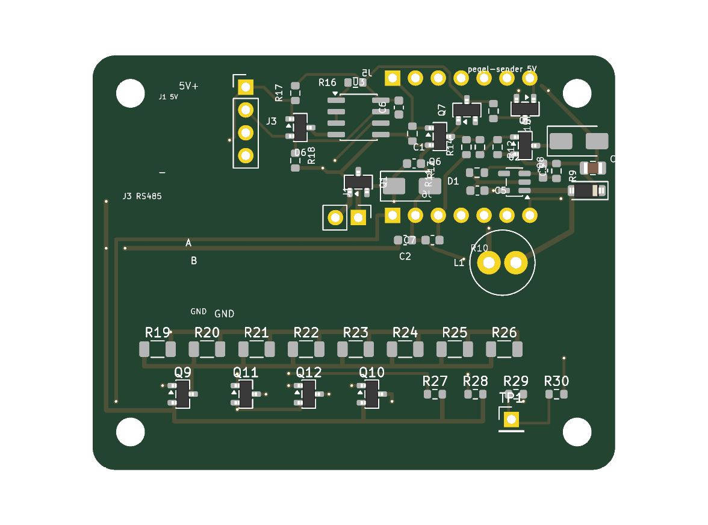
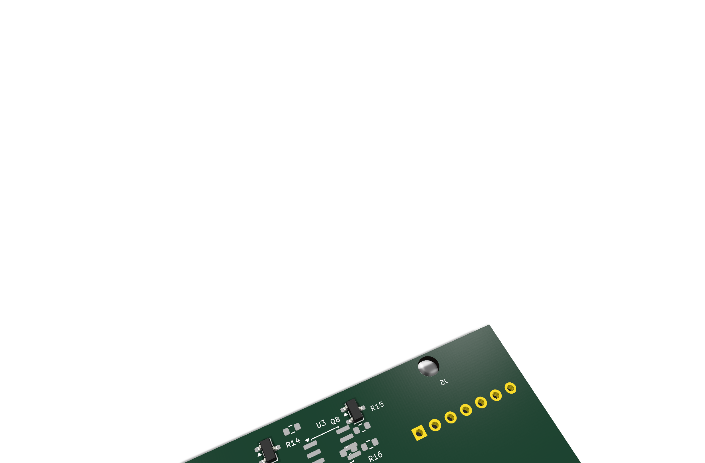

# pegel-sender-5v

**58 × 46 mm**, abgerundete Ecken, **M3 in allen vier Ecken**. **J1** 5 V (+/−). **J3** Sonde: **A, B, GND, 12 V** (Pin 4 = V12_PROBE).  
Laden nur über **BQ25101 auf dem XIAO**. **Q10** legt V5 an J6 Pin 1. **Q9** schaltet 8× 120 Ω (1,7 W an 5 V) dagegen: Heizen und Laden schließen sich aus. **TP1** mit einem Draht an **P0.09 / NFC1** auf der Rückseite des XIAO. Die Firmware schaltet dieses Pad beim ersten Start auf GPIO (UICR, einmal Reset). Unter 5 °C Heizung, ab 8 °C Laden. Kein J8, keine BAT-Pads auf der Platine; **L1/VBAT** an **BAT+** des XIAO löten.

 

## Firmware

`env:pegel_sender_5v_*` in `pegel.ini` (`PEGEL_5V_BOARD=1`). `pegel_5v_power` liest die nRF-Die-Temperatur und treibt P0.09.

## XIAO

Zwei **1×7**-Buchsen, **15,24 mm** Abstand (Seeed). Module **von unten**. 3D-Vorschau: `render_preview.py` (WXR-Modelle unter `models/`).

## Erzeugen

`python3 relayout.py` → `layout.py` (offen für KiCad). `design.py` = Netzliste.