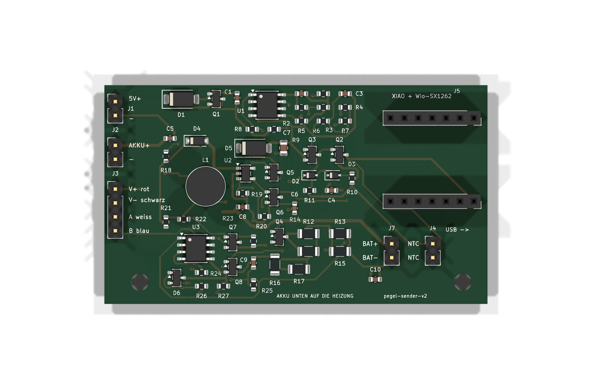

# pegel-sender-v2 — kompakte Trägerplatine mit Li-Ionen-Akku

Nachfolger von [`pegel-sender`](../pegel-sender/README.md) (bleibt für bestehende Stationen). 70 × 40 mm, 2 Lagen, alle SMD-Teile Basic oder Preferred bei JLCPCB (kein Extended), Anschlüsse als 2,54-mm-Löcher.

| | v1 | v2 |
|---|---|---|
| Akku | LiFePO4 1S, eigener Lader (TPS5430, 0,5 A) | Li-Ionen 1S am Lader des XIAO (BQ25101, 100 mA) |
| Eingang | Solarpanel 12-V-Klasse oder 12-V-Netzteil | 5 V: USB-C-Netzteil oder USB-C-Solarpanel (1–2 W reichen, `verify/winter_liion.py`) |
| Frostschutz | LM324 + NTC, Heizwiderstand extern | LM393 + NTC, Heizung aus 6 × 300 Ω auf der Platine (0,5 W) |
| Anschlüsse | Schraubklemmen | 2,54-mm-Löcher |
| Größe | 100 × 70 mm | 70 × 40 mm |

**Gleiche Firmware:** XIAO-Pins wie v1 (D0 Sonde, D6/D7 RS485, Wio-SX1262 auf D1–D5/D8–D10). Die Firmware erkennt den Li-Ionen-Akku an der Spannung am BAT-Pin des XIAO und nimmt dann die Li-Ionen-Schwellen.

## Schaltung

| Block | Bauteile | Funktion |
|---|---|---|
| Eingang | J1, Q1 AO3401A, D1 SMAJ5.0A | Verpolschutz ohne Spannungsverlust, Überspannung |
| Frost/Hitze | U1 LM393, NTC an J4, R1–R9 | Unter ~2 °C Laden aus und Heizung an, über ~43 °C Laden aus; ~1 K Hysterese; ohne NTC: kein Laden, Heizung an |
| Laden | Q2 AO3401A, Q3, D2/D3, R10/R11 | schaltet 5 V an den 5V-Pin des XIAO (dessen Lader) nur zwischen den Schwellen |
| Heizung | Q4, R12–R17 300 Ω 1206 | 0,5 W nur aus dem 5-V-Eingang, nachts nie aus dem Akku |
| Akku | J2 (Akku), J7 (Drähte zu BAT+/BAT− auf der Unterseite des XIAO) | Akku mit eigener Schutzschaltung verwenden |
| Sonde 12 V | U2 TPS61040, L1 10 µH, Q5/Q6 | wie v1, aus dem Akku |
| RS485 | U3 SP3485, Q7, Q8 | wie v1 |

**Aufbau:** Akku auf der Unterseite unter die Heizwiderstände kleben (Wärmeleitpad), den bedrahteten NTC (10 kΩ, B3950) an den Akku. Gehäuse mit ~3 cm Dämmung um Akku und Platine.

## Erzeugen

Wie v1 (KiCad 10, Java, Freerouting in `build/freerouting.jar`): `python relayout.py`. Anschlüsse, XIAO-Buchsen, Spule und Bohrungen liegen fest in `fixed_positions.py`; alle anderen Teile packt `gen_pcb.auto_place` in die Bereiche der Funktionsblöcke (`GROUP_REGIONS`). Teileprüfung: `python ../pegel-sender/verify/jlc_parts.py .`
