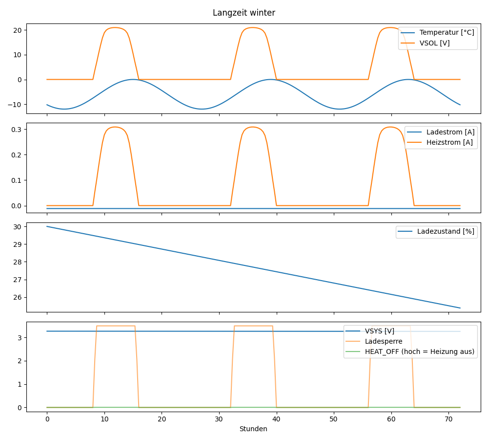
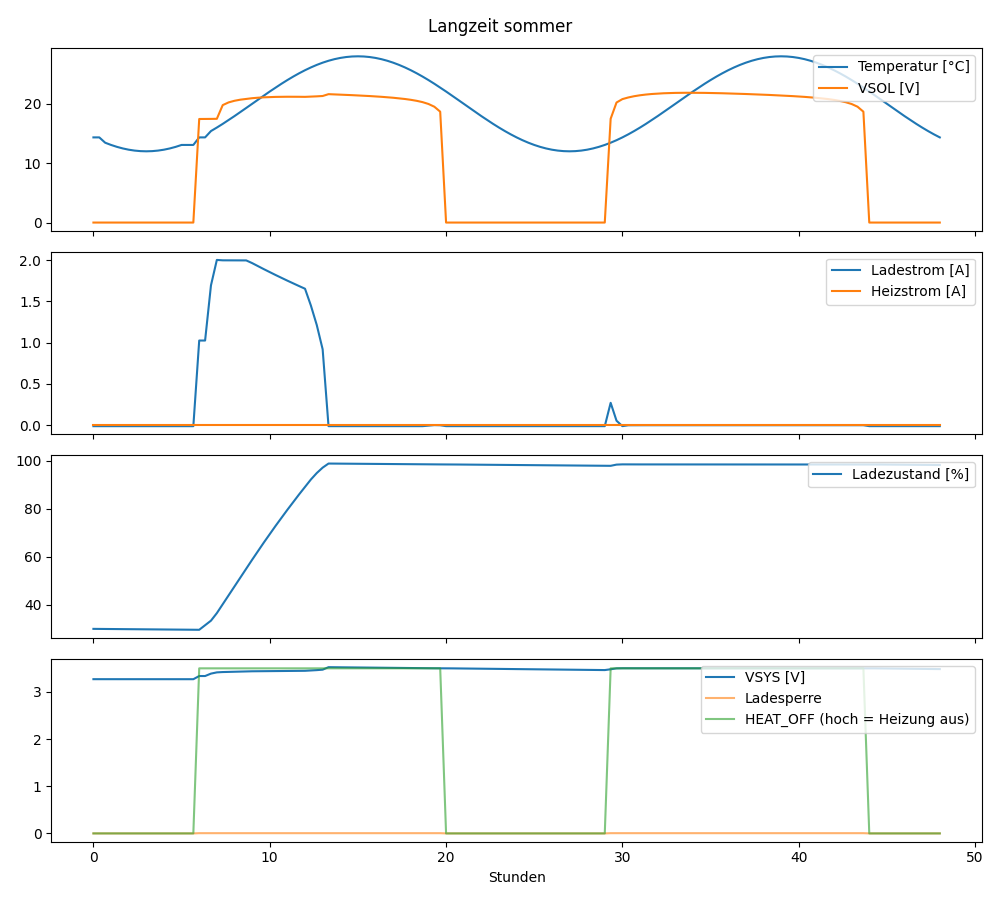

# Langzeitsimulation

## Winter (3 Tage)

- Schritte ohne Konvergenz (Wert davor übernommen): 0 von 217
- Ladezustand: 30 % → 25.4 % (min 25.4 %, max 30.0 %)
- Geladen: 0.00 Ah, entnommen: 0.83 Ah
- Heizenergie aus dem Panel: 98.0 Wh
- VSYS min/max: 3.26 / 3.27 V, XIAO_3V3 min: 3.04 V
- Ladestrom bei Ladesperre (CHG_INH hoch) max: -0.012 A
- Akkustrom nachts (Sonne aus) im Mittel: -11.5 mA

## Sommer (2 Tage)

- Schritte ohne Konvergenz (Wert davor übernommen): 4 von 145
- Ladezustand: 30 % → 98.3 % (min 29.6 %, max 98.9 %)
- Geladen: 12.57 Ah, entnommen: 0.29 Ah
- Heizenergie aus dem Panel: 0.0 Wh
- VSYS min/max: 3.27 / 3.52 V, XIAO_3V3 min: 3.05 V
- Ladestrom bei Ladesperre (CHG_INH hoch) max: 0.000 A
- Akkustrom nachts (Sonne aus) im Mittel: -11.3 mA

## Dunkelflaute

- Mittlerer Akkustrom ohne Sonne ≈ 11.5 mA → 65 Tage von voll bis leer (18 Ah)

