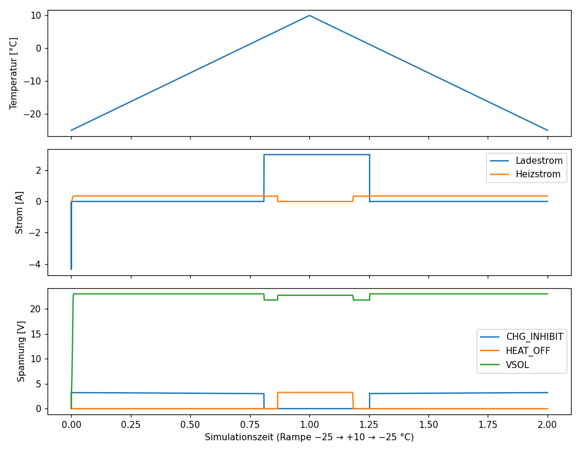
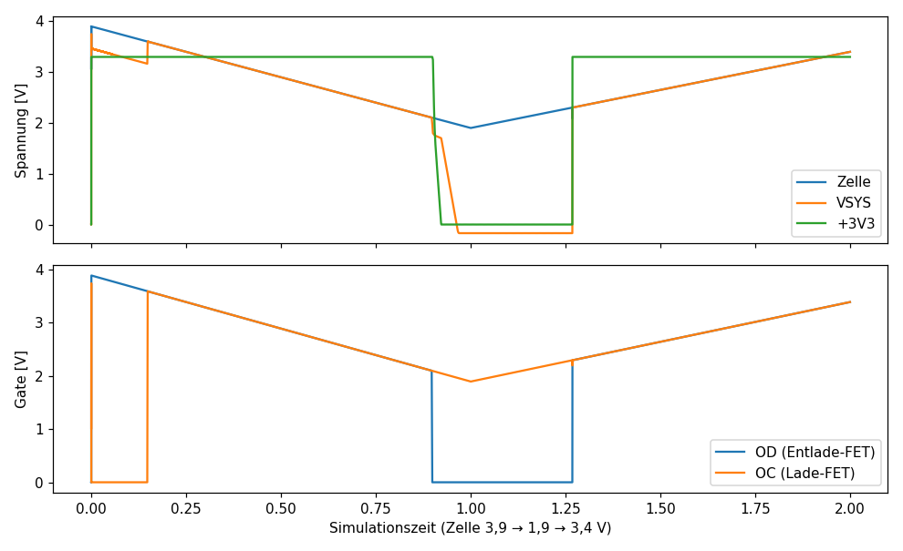
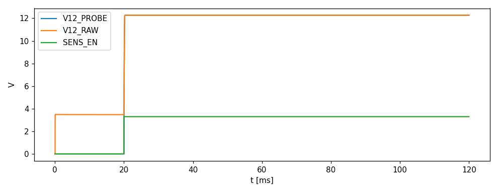

# Schwellen und Verläufe (SPICE)

| Größe | Wert |
|---|---|
| Laden frei beim Erwärmen ab [°C] | 3.33 |
| Ladesperre beim Abkühlen ab [°C] | 1.15 |
| Heizung aus beim Erwärmen ab [°C] | 5.33 |
| Heizung an beim Abkühlen ab [°C] | 3.55 |
| Netzteil erkannt ab DC_F [V] | 8.58 |
| Netzteil nicht mehr erkannt unter DC_F [V] | 4.8 |
| Lade-FET wieder an unter Zelle [V] (Überladeschutz) | 3.6 |
| Entlade-FET aus unter Zelle [V] (Tiefentladung) | 2.1 |
| Entlade-FET wieder an über Zelle [V] | 2.3 |
| +3V3 min. solange Akku verbunden [V] | 3.3 |
| Sonde 30 mA: V12_PROBE Endwert [V] | 12.3 |
| Sonde 30 mA: Anstieg auf 90 % [ms] | 0.141 |
| Sonde 30 mA: Spitzenstrom Q4 [A] | 0.0301 |
| Sonde 30 mA: Ugs Q4 min [V] | -6.15 |
| Sonde 80 mA: V12_PROBE Endwert [V] | 12.3 |
| Sonde 80 mA: Anstieg auf 90 % [ms] | 0.149 |
| Sonde 80 mA: Spitzenstrom Q4 [A] | 0.0801 |
| Sonde 80 mA: Ugs Q4 min [V] | -6.13 |
| Sonde 200 mA: V12_PROBE Endwert [V] | 12.2 |
| Sonde 200 mA: Anstieg auf 90 % [ms] | 0.182 |
| Sonde 200 mA: Spitzenstrom Q4 [A] | 0.2 |
| Sonde 200 mA: Ugs Q4 min [V] | -6.11 |

