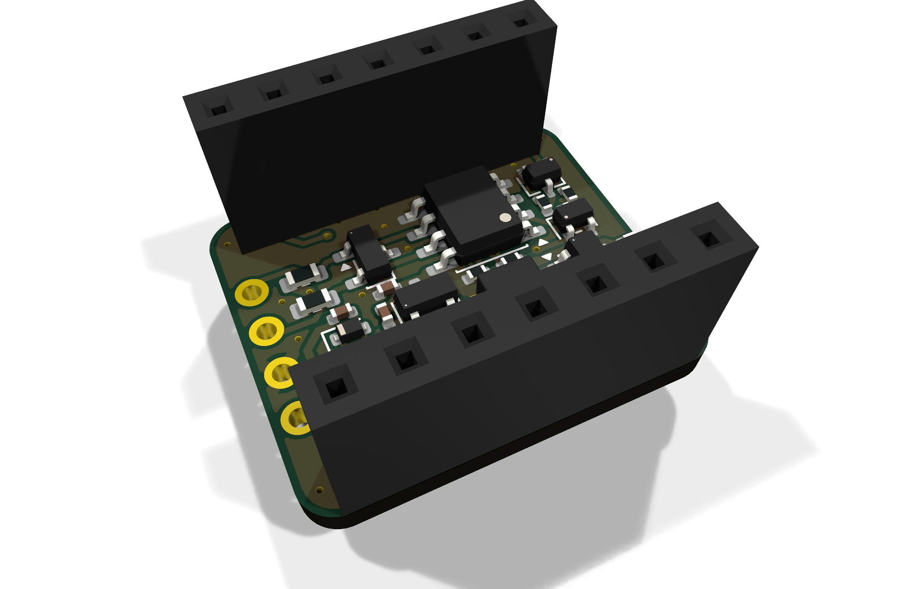
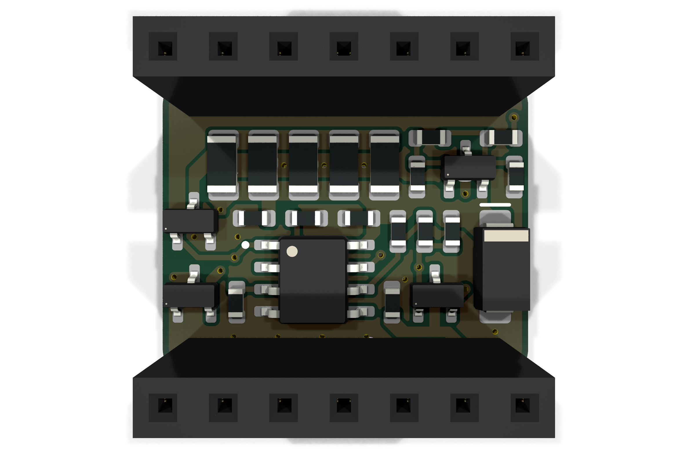
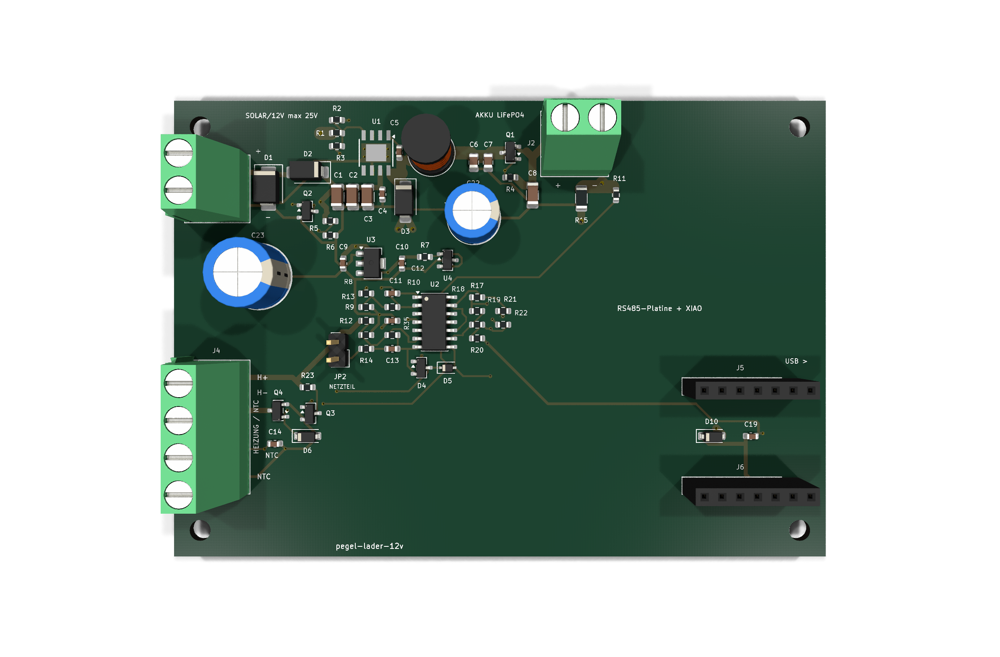

# pegel-stapel: Ladeplatine + RS485-Platine zum Stapeln

Die Sender-Elektronik in zwei Platinen, gestapelt wie der XIAO selbst. Unten liegt eine Ladeplatine, wahlweise für 5 V oder 12 V. Darüber sitzt die RS485-Platine, ganz oben XIAO nRF52840 + Wio-SX1262. Alle Platinen haben die XIAO-Leisten an derselben Stelle, und die Signale laufen durch die Stapelbuchsen. Firmware: die normalen Umgebungen `pegel_sender_a`/`_b`; den Akku (Li-Ionen oder LiFePO4) erkennt sie selbst, von der Temperaturregelung weiß sie nichts.

| Platine | Inhalt | Größe |
|---|---|---|
| [`rs485/`](rs485/) | 12 V für die Sonde (TPS61040, ausgelegt auf 13 mA), RS485 (SP3485), Lötstellen J3 **A, B, GND, 12V**, durchkontaktiert im 2,54-mm-Raster | 20,955 × 17,78 mm (Umriss des XIAO) |
| [`lader-5v/`](lader-5v/) | **Thermolader 5 V:** 5-V-Eingang J1, NTC J4, LM393: unter ~2,5 °C Heizung 5 × 300 Ω (0,42 W), über ~42 °C Laden aus, dazwischen Laden über den XIAO | 20,955 × 17,78 mm (Umriss des XIAO) |
| [`lader-12v-netz/`](lader-12v-netz/) | **Thermolader 12 V Netzteil** (9–15 V): TPS54331 auf 4,88 V, dahinter wie 5 V. Verdrahtet, GND und Versorgung als Flächen | 21,975 × 17,78 mm |
| [`lader-12v-solar/`](lader-12v-solar/) | **Thermolader 12 V Solar** (36 Zellen, Leerlauf bis 25 V): TPS5430 auf 4,92 V mit Panelregelung, dahinter wie 5 V. Noch nicht verdrahtet | 31,455 × 17,78 mm |
| [`lader-12v/`](lader-12v/) | Solar/12 V, LiFePO4-Lader, Frostschutz, Schaltung, Klemmen und Bohrungen wie `pegel-sender-12v` (gleiches Gehäuse) | 100 × 70 mm |



| | |
|---|---|
|  |  |

## Stapel

- **Stapelmaß:** Die XIAO-Leisten liegen auf allen Platinen gleich, 15,24 mm auseinander, USB-C nach rechts ([`tools/stack.py`](tools/stack.py)). RS485-Platine und Thermolader haben den Umriss des XIAO und keine Bohrungen, das Langloch-Symbol unten zeigt die USB-C-Kante. Die 12-V-Ladeplatine hat nur die vier Gehäusebohrungen in den Ecken.
- **Ladeplatine:** zwei Buchsenleisten 1×7 (8,5 mm).
- **RS485-Platine:** zwei Stapel-Buchsenleisten 1×7 mit langen Stiften. Die Stifte gehen nach unten in die Ladeplatine, der XIAO steckt oben.
- **5-V-Ladeplatine (Thermolader 5 V):** nur so groß wie der XIAO, ohne Bohrungen; sie hängt an den beiden Leisten. Das Langloch-Symbol auf der Unterseite zeigt, an welcher Kante die USB-C-Buchse des XIAO sitzt.
- **Halt:** Die Platinen halten nur an den Leisten, Abstandsbolzen gibt es nicht.
- **Signale zwischen den Platinen:** nur über die 14 Pins der XIAO-Leisten, nämlich D0 (Sonde ein), D6/D7 (RS485), 3V3, GND und 5V. Keine Drähte.
- **Frostschutz in Hardware, beide Ladeplatinen:** ein NTC 10 kΩ B3950 am Akku.
  - 5 V: Eine Hälfte des LM393 trennt unter ~2,5 °C den Lader des XIAO vom 5-V-Eingang (Q2) und heizt, bis der Akku wieder ~4,6 °C hat. Die andere trennt über ~42 °C (ungünstigste Toleranzen 39,2–44,8 °C) bis ~37 °C (Q3). Ohne NTC: kein Laden, Heizung an. NTC-Kurzschluss: kein Laden, Heizung aus.
  - 12 V: Ein LM324 regelt wie bei `pegel-sender-12v`.

## Versorgung

- **Sonde:** Der 12-V-Wandler läuft aus dem **3V3-Pin** des XIAO, nicht aus dem Akku. Bei 5 V liefert der Regler des XIAO die 3,3 V (SGM2040: 280 mA garantiert, höchstens 10 µF am Ausgang empfohlen). Bei 12 V speist die Ladeplatine den 3V3-Pin über D10 direkt aus dem LiFePO4-Akku. Die Sonde braucht 13 mA bei 12 V, das sind ~61 mA aus 3,3 V und nur während der Messung.
- **Einschalten der Sonde:** Q7 schaltet Wandler und SP3485 gemeinsam. C9/C11 rampen die 3,3 V, C10/D7/R19 die 12 V (~65 ms, zählt zur Vorlaufzeit von 2 s). Gerechnet mit den ungünstigsten Grenzen bleibt 3V3 bis 100 µF in der Sonde über 3,1 V, bei 220 µF 2,6 V. Am ersten Aufbau mit echter Sonde messen.
- **Sondenkabel:** Eine 1 hält auf dem Bus nur die Vorspannung R17/R18 (1 kΩ). Bei 9600 Bd reicht das rechnerisch für ~180 m (120 pF/m). Kein Abschlusswiderstand nötig.
- **5 V:** Li-Ionen-Akku an die BAT-Pads des XIAO und unter die Ladeplatine kleben, mit den Heizwiderständen darüber. Der NTC kommt an den Akku. J4 (NTC) und J1 (5 V) sind Lötpads auf der Unterseite. Stiftenden kürzen und samt Pads gegen den Akku isolieren.
- **Wärme:** nachgerechnet in [`verify/report/thermal.md`](verify/report/thermal.md) (700 mAh, 3 cm Styropor). Die Heizung reicht bis etwa −25 °C, bei 4,5 V bis etwa −19 °C. **Fällt der NTC ab, heizt sie dauernd:** der Akku kommt bei 20 °C Außenluft auf ~50 °C, bei 35 °C auf ~64 °C (61–69 °C); über seine 60 °C kommt er ab ~31 °C Außenluft (ungünstig ab 26 °C). Die Hitzeabschaltung verhindert das nicht, sie schaltet nur das Laden. NTC deshalb sicher am Akku befestigen, neben der Platine, nie zwischen Platine und Akku: dort lädt es bei teils gefrorenem Akku. Ab ~35 °C Außenluft lädt es nur zeitweise, über ~40 °C gar nicht.
- **Kupfer (5 V):** GND beidseitig als Fläche ohne GND-Bahnen, V5, HEAT_N und XIAO_5V als Flächen, Signale 0,3 mm, übrige Versorgung 0,6 mm, Abstand ≥ 0,2 mm. Nach Änderungen in KiCad Flächen neu füllen (Taste B).
- **Kupfer (RS485):** GND beidseitig als Fläche, V3_SW und Schaltknoten als Flächen, Signale 0,3 mm, 12 V und XIAO-3V3 im Hauptweg 0,6–0,8 mm. Alle Vias 0,6/0,3 mm, mindestens 0,15 mm neben dem eigenen und 0,2 mm neben fremden SMD-Pads. Engste Versorgungsstelle: V3_SW zwischen R16 und L1 mit 0,28 mm. Nach Änderungen in KiCad Flächen neu füllen (Taste B).
- **12 V:** Akku, Panel und Heizung/NTC wie bei `pegel-sender-12v` an J2, J1 und J4.

Alle SMD-Teile sind Basic oder Preferred bei JLCPCB, kein Extended: `python ../pegel-sender-12v/verify/jlc_parts.py rs485` usw.

## Bearbeiten und exportieren

Die `.kicad_pcb` sind die Originale. Lagen, Bahnen und Beschriftung macht man von Hand in KiCad, kein Skript platziert oder routet. `design.py` je Platine ist die Soll-Netzliste und die Stückliste; bei Änderungen an der Schaltung beides nachziehen.

Prüfen (DRC, Abgleich mit `design.py`), ohne etwas zu schreiben:

```bash
python tools/fab.py --check
```

Prüfen und Fertigungsdaten (`<platine>/fab/`) samt 3D-Bildern (`<platine>/preview/`) schreiben, einzelne Platine z. B. `python tools/fab.py lader-5v`:

```bash
python tools/fab.py
```

**Vor dem Bestellen, RS485-Platine:** Die Drehlage von Q6, Q8, D4, D5 und D7 im JLC-Viewer prüfen. L1 (LCSC C45403) wird nicht bestückt, von Hand löten.

**Offen, 12-V-Thermolader:** Netzteil: verdrahtet, 21,975 mm lang, GND beidseitig als Fläche ohne GND-Bahnen (mind. 0,3 mm breit; Rückstrompfade Eingang, Wandler und XIAO mind. 0,89 mm, Ausgangskondensator C7 zum XIAO 0,4 mm; VIN_RAW- und GND-Via sitzen in den Drahtpads J1.1/J1.2), Heizreihen (V5, HEAT_N) und Schaltknoten als Flächen, Signale 0,3 mm, Versorgung 0,6 mm, Ecken R 1,5 mm (stehen an den Ecken bis 0,17 mm über den XIAO). Solar: Teile wie am 5-V-Lader, der Wandler links von x = 0, noch ohne Leiterbahnen; `fab.py` exportiert erst nach dem Verdrahten. Gegenüber dem 5-V-Lader kleinere Gehäuse, alle Basic/Preferred: R1, R3–R6, R8, R9 und C1, C2, C4 in 0402, die Heizung in 0805 (je 0,08 W von 0,125 W), C3 in 0805; am Netzteil ein 47-µF-Ausgangskondensator statt zwei 22 µF. L1 (LCSC C83472) von Hand löten. Wärme nachgerechnet in [`verify/report/thermal-12v.md`](verify/report/thermal-12v.md): Fällt der NTC ab, erreicht der Akku 60 °C schon ab ~21 °C Außenluft (Solar) bzw. ~28 °C (Netzteil), weil die Wandlerverluste dazukommen. Die 0805-Heizung liegt dann beim Solar-Lader ab ~38 °C Außenluft über ihrer Lastminderung. Der Lader des XIAO bricht nach 10 h ab (~1 Ah bei 100 mA).

LM393 (5 V) und LM324 (12 V) sind laut Datenblatt bis 0 °C spezifiziert. Gleichwertig bis −40 °C wäre der LM2903, aber Extended bei JLCPCB (Rüstgebühr ~3 USD).
