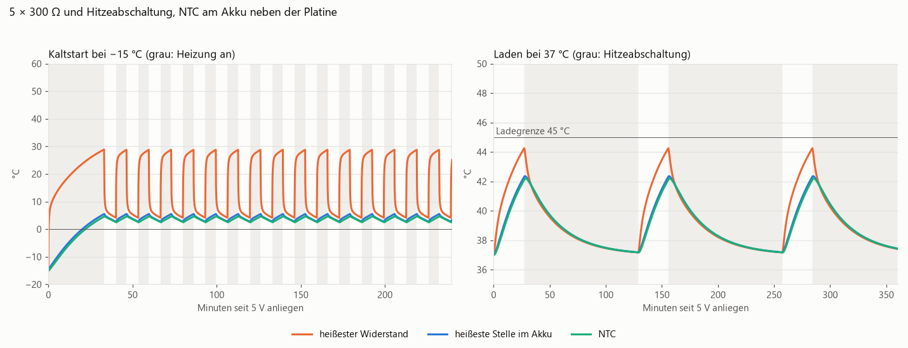
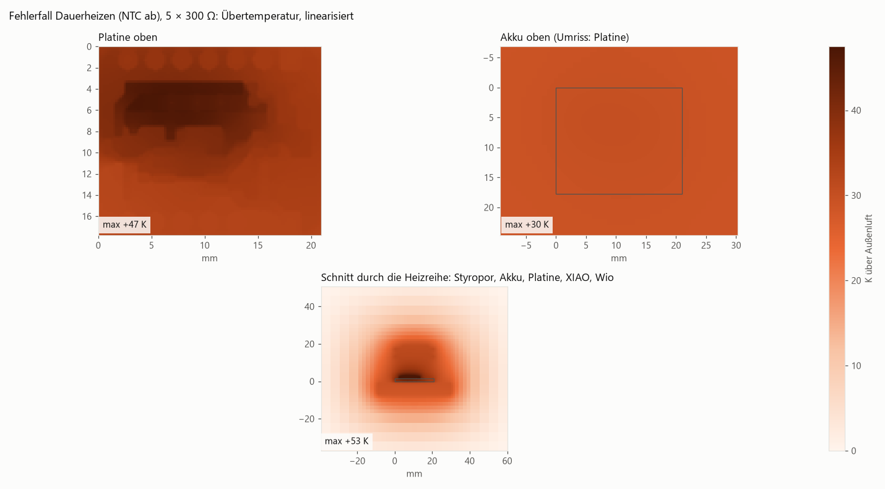

# Erwärmung der 5-V-Ladeplatine

Erzeugt von `thermal.py` und `thermal_report.py`. Rechnung, keine Messung. 3D-Finite-Volumen mit 1,5 Mio. Zellen, Kupfer samt GND-Flächen, Vias und Bauteile aus der `.kicad_pcb`.

**Aufbau:** Ladeplatine + XIAO + Wio-SX1262 ohne RS485-Platine, Pouchzelle 700 mAh (39,5 × 31,5 × 5,9 mm, 15 g) mit 1,2 mm Schaumklebeband darunter, rechteckiger Hohlraum, rundum 30 mm Styropor, zwei 5-V-Adern AWG 24 nach außen, 5,0 V am Eingang, keine Sonne. Die Zelle ist größer als der XIAO und steht über.

**Bestückung:** 5 × 300 Ω, 0,42 W, fünf Widerstände links in der Heizreihe. Rechts die Hitzeabschaltung.

## Schwellen aus `design.py`

| Schwelle | Nennwert | ungünstigste Toleranzen |
|---|---|---|
| Heizung an, Laden aus unter | 2,5 °C | 1,4 bis 3,8 °C |
| Heizung aus, Laden ab | 4,6 °C | 3,4 bis 5,8 °C |
| Hitze: Laden aus über | 42,1 °C | 39,2 bis 44,8 °C |
| Hitze: Laden wieder unter | 37,2 °C | 34,3 bis 39,9 °C |

Toleranzen: R 1 %, NTC 1 %, B 1 %, 5 mV Offset, 0–250 nA Eingangsstrom, 0,02–0,2 V Sättigung, 4,5–5,25 V.

## Normalbetrieb im Frost, NTC am Akku neben der Platine

| Außenluft | Widerstand | Platine | LM393 | Akku max. | bis Laden |
|---|---|---|---|---|---|
| −10 °C | 29 °C | 24 °C | 16 °C | 5,6 °C | 21 min |
| −15 °C | 29 °C | 23 °C | 16 °C | 5,5 °C | 33 min |
| −20 °C | 29 °C | 23 °C | 15 °C | 5,5 °C | 54 min |

Die Heizung reicht bei 5 V bis −24,7 °C Außenluft.

## Fehlerfall NTC ab oder gebrochen: Dauerheizen

Strahlung und Leitwerte temperaturabhängig. Grenze des Akkus laut Datenblatt: 60 °C. Unsicherheit der Übertemperatur −10/+18 % (Empfindlichkeit unten): bei 5 × 300 Ω und 35 °C Außenluft also 61 bis 69 °C.

| Bestückung | Akku bei −20 °C | bei 20 °C | bei 35 °C | Widerstand bei 20 °C | 60 °C im Akku ab 20 °C nach | ab 35 °C nach |
|---|---|---|---|---|---|---|
| 5 × 300 Ω | 14 °C | 50 °C | 64 °C | 73 °C | nie | 52 min |

Im Dauerheizen erreicht der Akku 60 °C ab 31 °C Außenluft, im ungünstigsten Fall ab 26 °C. Die Hitzeabschaltung hilft dagegen nicht: sie hängt am selben NTC und schaltet nur das Laden.

## Lage des NTC (−10 °C)

| NTC | Widerstand | Akku max. | kälteste Stelle im Akku beim Laden |
|---|---|---|---|
| unter der Heizung (Spalt) | 23 °C | 2,3 °C | −2,6 °C |
| Akku oben, neben der Platine | 29 °C | 5,6 °C | 2,2 °C |
| Akku unten, Mitte | 30 °C | 6,5 °C | 2,4 °C |
| Akku Schmalseite | 30 °C | 6,3 °C | 2,5 °C |

## Verklebung (−10 °C)

| Spalt 1,2 mm | Widerstand | Platine | Akku max. |
|---|---|---|---|
| Klebeband | 29 °C | 24 °C | 5,6 °C |
| Wärmeleitpad | 22 °C | 17 °C | 6,2 °C |
| Luftspalt | 36 °C | 30 °C | 5,2 °C |

Der 1206 hat 0,083 W. Nach der üblichen Lastminderung (0,25 W bis 70 °C, 0 W bei 155 °C) darf er das bis 127 °C.

## Laden bei Wärme (100 mA, Linearlader im XIAO, NTC neben der Platine)

| Außenluft | Akku ohne Abschaltung | Akku beim Laden, mit Abschaltung | lädt in der Zeit |
|---|---|---|---|
| 25 °C | 34,1 °C | 34,1 °C | 100 % |
| 30 °C | 39,1 °C | 39,1 °C | 100 % |
| 35 °C | 44,1 °C | 42,3 °C | 53 % |
| 37 °C | 46,1 °C | 42,3 °C | 22 % |
| 40 °C | 49,1 °C | 42,3 °C | 0 % |
| 45 °C | 54,1 °C | – | 0 % |

Ladegrenze des Akkus: 45 °C.

## Empfindlichkeit (Dauerheizen mit 0,42 W, linear, über Außenluft)

| Änderung | Akku max. | gegen Basis | Widerstand |
|---|---|---|---|
| Basis | +30,2 K | 0,0 % | +53 K |
| Gitter 0,35 mm | +29,8 K | −1,3 % | +53 K |
| Gitter 0,15 mm | +30,2 K | 0,3 % | +53 K |
| Styropor 0,032 W/mK | +32,2 K | 6,7 % | +55 K |
| Styropor 0,040 W/mK | +27,4 K | −9,2 % | +50 K |
| Styropor bündig ausgeschnitten | +31,3 K | 3,9 % | +55 K |
| Luft im Hohlraum 0,035 W/mK | +31,6 K | 4,8 % | +56 K |
| Luft im Hohlraum 0,090 W/mK | +28,8 K | −4,4 % | +50 K |
| außen windstill, 6 W/m²K | +30,7 K | 1,9 % | +54 K |
| außen Wind, 25 W/m²K | +29,6 K | −1,9 % | +52 K |
| ohne 5-V-Leitung | +35,5 K | 17,7 % | +59 K |
| 5-V-Leitung 2 × 0,5 mm² | +27,2 K | −9,9 % | +50 K |
| Zelle 602248 (schmal, lang) | +30,7 K | 1,8 % | +53 K |
| Zelle quer 0,3 W/mK | +30,5 K | 1,1 % | +53 K |
| FR4 0,4 W/mK | +30,6 K | 1,4 % | +56 K |
| Stifte 40 W/mK | +30,6 K | 1,5 % | +54 K |
| Kupfer 70 µm | +30,0 K | −0,6 % | +51 K |

## Prüfung des Lösers

| Fall | Modell | Soll | Abweichung |
|---|---|---|---|
| Platte, Scheitel gegen Formel | 3,000 | 3,000 | −0,00 % |
| Würfel in Styropor, K/W gegen Formfaktor | 25,032 | 24,958 | 0,30 % |
| reduziert gegen voll, film nach 300 s | 27,043 | 27,043 | −0,00 % |
| reduziert gegen voll, cell nach 300 s | 4,268 | 4,268 | 0,00 % |

Energiebilanz der Dauerzustände je Verklebung: Wärme nach außen = eingespeiste Leistung auf 10⁻⁵.

## Grenzen

Keine Konvektionsströmung in den Hohlräumen (wirksamer Leitwert), XIAO und Wio als Blöcke, kein Wärmewiderstand an Steckkontakten, keine Fugen im Styropor, keine Eigenerwärmung des NTC, Panel liefert immer 5 V. Bei 4,5 V sinkt die Heizleistung auf 81 %. Die Zellwerte für die Wärmeleitung stammen von einer LFP-Pouchzelle.
